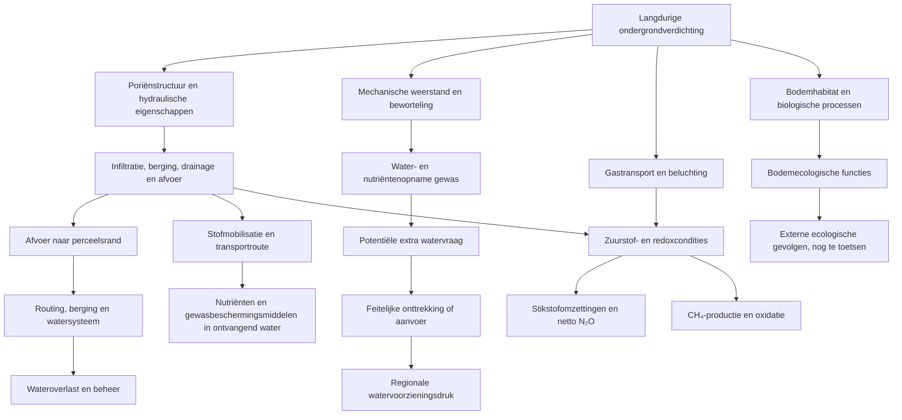

# Off-site effectinventarisatie ondergrondverdichting, expertgroep 12 oktober 2026

**Status:** DISCUSSION_DRAFT / NOT QUALIFIED. Aanvulling op bestaande projectarchitectuur, geen vervanging van `docs/02_theoretical_framework.md`, `docs/49_project_effect_pathway_matrix_v0_1.md` of canonieke datasets. Geen nieuwe kosten- of emissiefactoren toegelaten.

## Afbakening en herkomst

Gebaseerd op het verslag van het eerste off-site-overleg (vorige week) en de bespreking van Defra SP1606 en Pulido-Moncada et al. (2022). De expertgroep onderzoekt langdurige ondergrondverdichting door berijding, indicatief 30–50 cm onder maaiveld in akkerbouw en 20–40 cm in grasland. Bovengrondverdichting, vertrapping en verslemping zijn niet zelfstandig het onderzoeksobject. Het causale effect van uitsluitend ondergrondverdichting moet bij iedere literatuurclaim afzonderlijk worden getoetst.

## Aanvulling op bestaande pathwaymatrix

De bestaande F1–F5 hydrologische routes blijven ongewijzigd. F6 bevat nu nutriënten en gewasbeschermingsmiddelen gezamenlijk; voor expertbeoordeling zijn dit **twee afzonderlijke subroutes**, zonder nieuwe canonieke pathway-ID's toe te kennen. Broeikasgassen en bodemecologie zijn **kandidaat-uitbreidingen**, niet reeds admitted pathways.

| Expertspoor | Aansluiting bestaande route | Fysisch/biologisch eindpunt | Extern gevolg | Trekkerschap volgens overleg |
|---|---|---|---|---|
| Extra wateroverlast | F1–F4 | Afvoerhydrogram, timing, piek en systeemrespons | Overlast, schade of extra beheer | Ab |
| Extra wateraanvoer | O3 en F5 | Potentiële behoefte → feitelijke vraag → feitelijke levering | Aanvoer-, schaarste- en verdelingsgevolgen | Ab |
| Broeikasgassen | Kandidaat, nog geen F-ID | Netto N₂O- en CH₄-flux, niet alleen denitrificatie | Klimaateffect | Piet en tweede expert nog open |
| Nutriënten | F6 subroute | N/P-vracht en route naar ontvangend water | Waterkwaliteit/ecologie/zuivering | Piet |
| Gewasbeschermingsmiddelen | F6 subroute | Middelafhankelijke vracht en blootstelling | Ecologische/zuiveringsgevolgen | Wim |
| Bodembiodiversiteit | Kandidaat, nog geen F-ID | Verandering bodemleven en bodemfuncties | Off-site alleen als externe receptor/doorwerking aangetoond | Expert door Guido te identificeren |
| Overige / ontbrekende effecten | Inventarisatie, geen zelfstandige kostenpost | Nog te bepalen | Nog te bepalen | Gezamenlijk |

## Conceptueel causaal netwerk

**Leesregel:** pijlen zijn te toetsen hypothesen of mechanismen; het diagram bewijst geen teken of omvang van de verandering. De waterbalans vormt een gemeenschappelijke stam, maar waterkwaliteit, klimaat en ecologie vragen aanvullende processen. Onsite-effecten en externe effecten mogen niet dubbel worden gewaardeerd.

## Literatuurstatus en beperkingen

- **Defra SP1606 / Graves et al. (2015):** methodologisch en als relatieve signalering van potentiële kostenposten bruikbaar. De Britse verdichtingsdefinitie en aannames zijn niet gelijk aan onze ondergrondafbakening. Nationale percentages of kosten zijn geen Nederlandse parameters.
- **Pulido-Moncada, Petersen & Munkholm (2022),** *Soil compaction raises nitrous oxide emissions in managed agroecosystems. A review*, Agronomy for Sustainable Development 42:38, DOI: 10.1007/s13593-022-00773-9. Veel bewijs betreft bovengrondverdichting; de specifieke bijdrage van ondergrondverdichting aan netto N₂O-emissie is onvoldoende gekwantificeerd. Gasdiffusiviteit kan verklarender zijn dan alleen WFPS.
- De review bespreekt Daisy-simulaties van extra gasvormig stikstofverlies **N₂ plus N₂O**; dat resultaat mag niet als afzonderlijke N₂O-emissiefactor worden gebruikt.

## Uniform onderzoeksblad per spoor

Leg per effect vast: (1) afbakening tot ondergrondverdichting; (2) passende current/reference; (3) bron en empirisch/mechanistisch/modelmatig bewijs; (4) fysische indicator en teken/onzekerheid; (5) route en ruimtelijke schaal; (6) externe ontvanger en mogelijke schade; (7) fysieke kwantificeerbaarheid; (8) mogelijke monetarisering en perspectief; (9) overlap/dubbeltellingen; (10) ontbrekende effecten en gegevens; (11) minimaal noodzakelijke volgende onderzoeksstap.

Rapporteer afzonderlijk: **monetair**, **fysiek niet-monetair**, **kwalitatief onderbouwd** en **kennislacune**. Afwezigheid van monetarisering betekent niet nul schade. Houd tevens onzekerheid in toestand, respons, attributie, overdracht en waardering afzonderlijk.

## Beslissingen gevraagd van expertgroep

1. Bevestig de zes werksporen en open inventarisatie zonder dat nieuwe canonieke pathway-ID's al worden vastgesteld.
2. Toets de causaliteit van uitsluitend ondergrondverdichting, met nadruk op gasemissies en biodiversiteit.
3. Scheid bij wateraanvoer potentiële behoefte van feitelijke levering en regionale kosten.
4. Beoordeel per spoor brongebied, transport en receptor; soilscapes zijn bronindeling, geen universele off-site schadefactor.
5. Kies per spoor de kleinste zinvolle stap in 2026; modellering alleen als ze aantoonbaar relevante onzekerheid reduceert.

**Integratievoorwaarde:** na expertbeoordeling en evidence-qualification de formele pathwaymatrix, schema's en traceability in samenhang aanpassen; dit discussiedocument zelf creëert geen nieuwe admitted wetenschappelijke claims.
