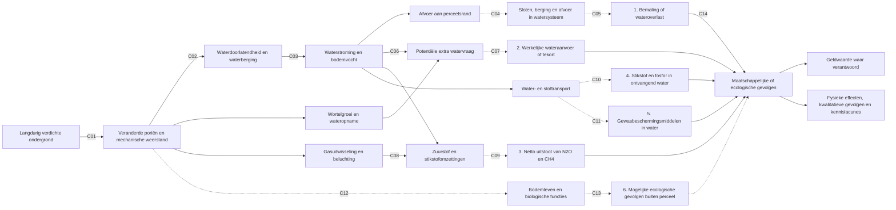

# Gezamenlijke causale flowchart en effectmatrix off-site v0.2

**Datum:** 12 oktober 2026. **Status:** concept voor de expertgroep, niet gekwalificeerd als rekenmodel. **Afbakening:** langdurige ondergrondverdichting door berijding, globaal 30–50 cm bij akkerbouw en 20–40 cm bij grasland. De codes C01–C14 zijn **verwijzingen naar deze tabel**, geen officiële pathway-ID's. Bestaande Git-routes F1–F6 en O3 blijven leidend.

## Hoe lees je de figuur?

Begin links bij de verdichte ondergrond. Via veranderingen in bodemstructuur, water en zuurstof kunnen verschillende gevolgen ontstaan. **De code op een pijl verwijst rechtstreeks naar dezelfde code in de tabel eronder.** Een pijl geeft een te onderzoeken oorzakelijke relatie aan; hij betekent niet dat het effect altijd toeneemt. De figuur laat alleen de hoofdroutes zien. Neveneffecten en terugkoppelingen staan in de toelichting.

Een **doorgetrokken pijl** betekent dat er een mechanistische of contextgebonden onderzoeksbasis is. Een **gestippelde pijl** betekent dat de specifieke doorwerking voor onze ondergrondafbakening of het uiteindelijke gevolg nog onvoldoende is onderbouwd. Deze lijnsoorten zijn **geen formele bewijsclassificatie**. De tabel geeft de beperkingen per verbinding.

## Causaal netwerk

**Belangrijke vereenvoudigingen:** C05 omvat hier twee verschillende uitkomsten, bemaling en wateroverlast, die in de uitwerking afzonderlijk moeten worden beoordeeld. C09 groepeert twee broeikasgassen voor de werkverdeling, niet omdat ze dezelfde biogeochemische productie- en oxidatieprocessen hebben. C14 staat bij de gemeenschappelijke overgang naar gevolgen, maar geldt afzonderlijk voor **alle zes** eindpunten. Hetzelfde geldt voor de pijl van bodemleven naar andere bodemfuncties: die mogelijke terugkoppelingen zijn omwille van leesbaarheid niet allemaal getekend.

## Matrix: wat betekent iedere pijl?

| Code | Verbinding in gewone taal | Wat weten we? | Wat moeten we nog toetsen? | Voortouw |
|---|---|---|---|---|
| C01 | Verdichting verandert de poriënstructuur en weerstand voor wortels | Er is experimentele en bodemfysische onderbouwing; diepte en belasting zijn bepalend | Ernst en blijvend effect in Nederlandse bodemtypen | Gezamenlijk |
| C02 | De veranderde poriën beïnvloeden doorlatendheid en waterberging | Nederlandse en Vlaamse methodestudies ondersteunen deze relatie | Passende hydraulische eigenschappen voor de onderzochte laag | Ab |
| C03 | Doorlatendheid en berging veranderen bodemvocht, drainage en afvoer | Lokale studies en modelberekeningen tonen contextafhankelijke effecten | Hoe reageren bodem en afvoer bij verschillende buien, grondwaterstanden en drainage? | Ab |
| C04 | Een deel van het water bereikt sloten en het regionale watersysteem | De overdrachtsroute is bekend, maar een algemene factor ontbreekt | Hoeveel water bereikt waar en wanneer het systeem? | Ab |
| C05 | Het ontvangende watersysteem kan extra bemaling of wateroverlast ondervinden | Er is een begrensde Tollebeek-rekenstructuur; geen gevalideerde nationale schadefactor | Berging, bediening, piekbelasting, getroffen functies en afzonderlijke kosten | Ab |
| C06 | Gewijzigd bodemvocht en beworteling kunnen extra watervraag veroorzaken | Er zijn scenario-afhankelijke aanwijzingen uit landbouwkundige modellen | Hoeveel verandert de behoefte bij welke bodem, gewas en weersituatie? | Ab |
| C07 | Extra behoefte kan leiden tot extra aanvoer, onttrekking of onvervuld tekort | Potentiële behoefte is niet hetzelfde als werkelijk geleverd water | Beregeningsgedrag, beschikbaarheid, waterverdeling en externe kosten | Ab |
| C08 | Minder of anders verbonden poriën veranderen gastransport en zuurstofcondities | Ondergrondonderzoek ondersteunt mogelijke langdurige veranderingen | Wanneer ontstaan zuurstofarme omstandigheden en hoe lang duren die? | Piet + tweede expert |
| C09 | Zuurstof- en stikstofprocessen kunnen de netto broeikasgasemissies veranderen | Algemene verdichtingsliteratuur ondersteunt het mechanisme, direct bewijs voor blijvende ondergrondverdichting is beperkt | Netto N₂O apart van CH₄ bepalen, inclusief mogelijke tegengestelde processen | Piet + tweede expert |
| C10 | Andere waterstroming kan N- en P-transport naar oppervlaktewater veranderen | Stromingsroutes en stoftransport zijn onderzocht; richting van vrachtverandering is onzeker | Gemeten vrachten, omzetting en vasthouden van stoffen onderweg | Piet |
| C11 | Andere waterstroming kan transport van gewasbeschermingsmiddelen veranderen | Preferente stroming en stoftransport zijn bekend, maar specifieke verdichtingsbijdrage niet | Middel, toepassingstijdstip, afbraak, concentratie en ontvangend water | Wim |
| C12 | Verdichting kan bodemleven en biologische functies veranderen | Reviews ondersteunen mogelijke effecten, maar de relevante ondergrondlaag is beperkt onderzocht | Welke organismen en functies reageren blijvend op 20–50 cm? | Guido zoekt expert |
| C13 | Verandering van bodemleven kan gevolgen buiten het perceel hebben | Voorlopig vooral een hypothese; lokale ecologische betekenis is op zichzelf relevant | Bestaat een afzonderlijk extern gevolg, naast waterkwaliteit en emissies? | Bodemecoloog |
| C14 | Fysieke effecten kunnen maatschappelijke of ecologische schade veroorzaken | Economische methoden bestaan, maar niet voor alle effecten een passende waardering | Wie ondervindt het gevolg, wat is in geld te waarderen, wat blijft niet-monetair en wat overlapt? | Alle experts |

## Vier verbanden die we gezamenlijk moeten bewaken

**Water:** dezelfde bodemwaterbalans beïnvloedt gewasopbrengst, droogte, afvoer en stoftransport. Het ene effect mag niet met een andere, tegenstrijdige waterbalans worden berekend.

**Stikstof:** plantopname, nitraatuitspoeling, denitrificatie en N₂O-emissie hangen samen. Meer denitrificatie betekent niet automatisch meer netto N₂O.

**Bodemleven:** verandering in bodemorganismen kan ecologisch relevant zijn, ook zonder geldwaarde. Alleen de doorwerking buiten het perceel hoort als zelfstandig off-site-effect in deze kostenroute.

**Kosten:** extra bemalingsuitgaven, overstromingsschade, zuiveringskosten en ecologische schade mogen niet zonder controle worden opgeteld. We onderscheiden bedrijfskosten, publieke uitgaven en maatschappelijke welvaartsverandering.

## Voorstel voor beoordeling door de expertgroep

1. **Klopt de pijl?** Is er direct bewijs voor blijvende ondergrondverdichting, alleen indirect bewijs, of slechts een hypothese?
2. **Klopt de richting?** Kan het effect ook afnemen of van teken veranderen?
3. **Ontbreekt een belangrijke schakel?** Bijvoorbeeld tussen waterafvoer en waterkwaliteit, of tussen bodemleven en externe ecologie.
4. **Is de gekozen uitkomst relevant?** Ook wanneer die niet betrouwbaar in geld kan worden uitgedrukt.
5. **Wat is de kleinste zinvolle vervolgstap in 2026?** Literatuur, bestaande metingen of gerichte modellering.

**Statusgrens:** dit is een gesprekshulpmiddel. Het introduceert geen nieuwe officiële effectcodes, toegelaten parameters of nationale schadebedragen. Een latere wetenschappelijke kwalificatie gebeurt via de bestaande bron- en bewijsregistratie.
