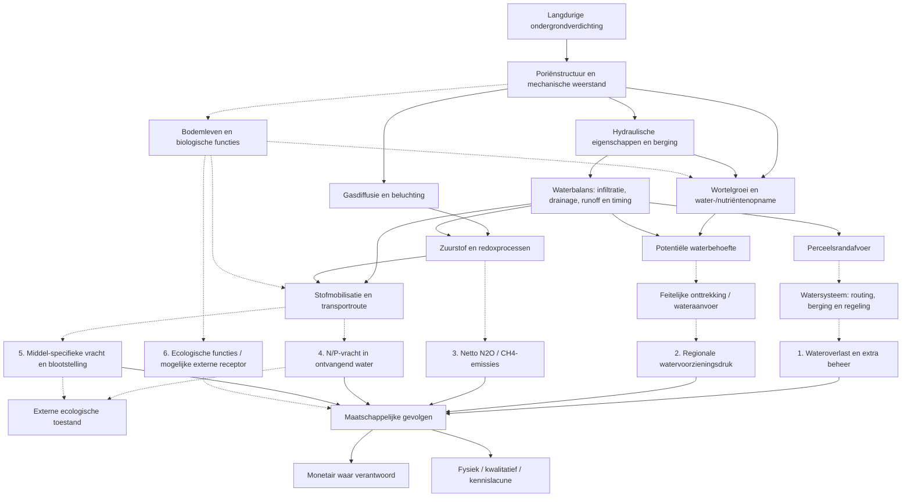

# Gezamenlijke causale flowchart en effectmatrix off-site v0.1

**Datum:** 12 oktober 2026. **Status:** DISCUSSION_DRAFT, te toetsen door expertgroep. **Scope:** langdurige ondergrondverdichting door berijding, indicatief 30–50 cm akkerbouw en 20–40 cm grasland. Gebaseerd op overlegverslag en bestaande Git-autoriteiten `docs/02_theoretical_framework.md`, `docs/49_project_effect_pathway_matrix_v0_1.md` en conceptdossiers 60–74. Geen nieuwe canonieke pathway-ID's of gekwalificeerde getallen.

## Leeswijzer

- **Doorgetrokken pijl**: een procesrelatie die in de huidige projectdocumentatie mechanistisch of met contextgebonden bewijs wordt ondersteund; dit bewijst niet de grootte of het teken voor elke situatie.
- **Gestippelde pijl**: de externe doorwerking of kwantitatieve relatie is nog onvoldoende gekwalificeerd voor onze specifieke ondergrondafbakening.
- **M**: mogelijke gemeenschappelijke mediator, niet automatisch een zelfstandige schadepost.
- De zes werksporen zijn **eindpunten of onderzoeksvragen**, geen zes onafhankelijke fysische processen.
- Kosten en niet-monetair gerapporteerde gevolgen staan naast elkaar; onbekend is niet nul.

## Causale netwerkfiguur

De figuur toont richting van de **onderzochte causale keten**, niet noodzakelijk een positieve of negatieve verandering van de grootheid. Vooral de gestippelde pijlen vragen bronspecifieke intended-use-kwalificatie. De pijlen naar VAL betekenen dat een maatschappelijke betekenis onderzocht wordt, niet dat een geldwaarde reeds bekend is.

## Effectmatrix voor expertbespreking

| ID | Causale verbinding | Huidige bewijsbasis | Open vraag / onzekerheid | Expert | Bestaande route |
|---|---|---|---|---|---|
| C01 | Verdichting → poriënstructuur / mechanische weerstand | Mechanistisch en veld-/modelbewijs, diepteafhankelijk | Persistentie en ernst per soilscape | Gezamenlijk | Gemeenschappelijke stam |
| C02 | Poriën → hydrauliek / berging | Meerdere Nederlandse/Vlaamse methodestudies | Toepasselijke hydraulische functies voor matched toestand | Ab | F1 |
| C03 | Hydrauliek → afvoer, drainage, timing | Lokale model-/casusresultaten | Context, bui, onderrand, drainage | Ab | F1 |
| C04 | Perceelsrand → netwerk / berging | Conceptuele en pilotkennis | Connectiviteit en tijdsafhankelijke overdracht | Ab | F2 |
| C05 | Netwerk → bemaling / wateroverlast | Bounded dispatchcode en historische systeeminformatie | Operationele gegevens, drempels en blootstelling | Ab | F3–F4 |
| C06 | Wortelzone → potentiële watervraag | Scenario-afhankelijk model-/veldcontext | Bodem/weer/gewas en referentie | Ab | O3 |
| C07 | Watervraag → werkelijke aanvoer / tekort | Nog onvoldoende direct gekwalificeerd | Gedrag, beschikbaarheid, bron, allocatie | Ab | F5 |
| C08 | Poriën/gastransport → redox | Fysisch mechanisme; subsoil literatuur | Gasdiffusie en tijdsafhankelijke zuurstof | Piet + open | Kandidaat |
| C09 | Redox/N-cyclus → netto N₂O/CH₄ | Algemene compaction-review; weinig specifiek subsoil-nettoflux | Emissierichting en jaarlijkse flux | Piet + open | Kandidaat |
| C10 | Waterstroming → N/P-mobilisatie/vracht | Mechanisme en indirecte transportstudies | Gemeten current/reference vracht | Piet | F6 subroute |
| C11 | Waterstroming → pesticidevracht/blootstelling | Preferente-flow en stoftransportliteratuur | Stof, timing, afbraak, receptor | Wim | F6 subroute |
| C12 | Verdichting → bodemleven / biologische functies | Algemene reviews; diepteafhankelijke respons onzeker | Langetermijnrespons 20–50 cm | Guido: expert zoeken | Kandidaat |
| C13 | Bodemecologie → externe ecosysteemfunctie | Vooralsnog hypothese | Afzonderlijke externe receptor, overlap met C10/C11 | Bodemecoloog | Kandidaat |
| C14 | Fysieke externe gevolgen → kosten / ecologische toestand | Waarderingsraamwerk bestaat | Schadeontvanger, welvaart versus uitgaven, dubbeltelling | Per expert + gezamenlijk | Alle routes |

## Cross-path afhankelijkheden

1. **Waterbalans** is gedeelde bron voor opbrengst, droogte, runoff en stoftransport. Geen verschillende impliciete hydrologische uitgangspunten per expert.
2. **Stikstofbalans** verbindt plantopname, nitraatuitspoeling, denitrificatie en netto N₂O. Een toename in één route is niet automatisch een even grote toename in een andere.
3. **Bodemleven** kan zowel eigen ecologische betekenis hebben als mediator zijn in andere routes; niet dubbel waarderen.
4. **Kosten** van extra pompen, wateroverlast, waterkwaliteit en ecosysteemdiensten kunnen overlappen. Beoordeel per receptor en economische definitie.
5. **Ruimtelijke schaal**: soilscape voor bron, watersysteem voor watergerelateerde externe gevolgen, atmosfeer voor emissies, ecologische receptor voor biodiversiteit.

## Checklist expertbespreking

- [ ] Is de afbakening tot langdurige ondergrondverdichting per pijl terecht?
- [ ] Zijn de gestippelde en doorgetrokken verbindingen juist geclassificeerd?
- [ ] Welke verbindingen missen of hebben mogelijk tegengestelde effecten?
- [ ] Is de off-site grens bij biodiversiteit overtuigend?
- [ ] Welke twee of drie verbindingen zijn het meest zinvol om in 2026 te toetsen?
- [ ] Welke uitkomsten blijven expliciet fysiek of kwalitatief, ook zonder eurobedrag?

**Toelatingsgrens:** deze matrix is een bespreekinstrument. Wijzig canonieke pathways, bewijsstatussen en rekenparameters pas na expertbeoordeling en de bestaande qualification-procedure.
