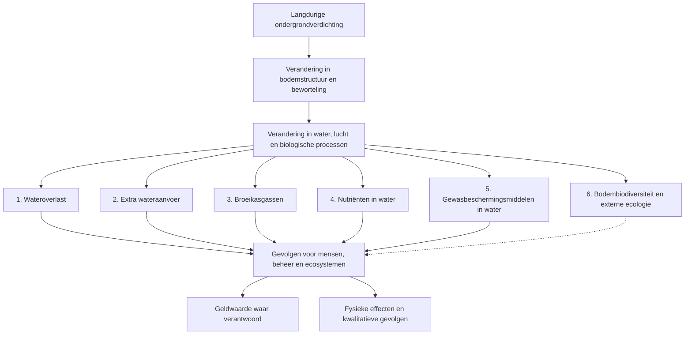

# Off-site effecten ondergrondverdichting: reviewpakket expertgroep

**12 oktober 2026 | CONCEPT TER BESPREKING | geen definitieve schadeberekening**

## 1. Wat onderzoeken we?

We onderzoeken de gevolgen van **langdurige ondergrondverdichting door berijding**. Als werkafbakening hanteren we ongeveer 30–50 cm beneden maaiveld bij akkerbouw en 20–40 cm bij grasland. Verdichting van de bovengrond, vertrapping en verslemping zijn niet zelf het onderwerp. Bij iedere bron toetsen we of die daadwerkelijk over onze ondergrondlaag gaat.

Het doel is niet alleen een schadebedrag. We willen (a) de effecten in kaart brengen, (b) waar verantwoord een fysieke verandering en economische schadebandbreedte bepalen, en (c) relevante ecologische en maatschappelijke gevolgen die niet goed in geld zijn uit te drukken zichtbaar houden.

De gezamenlijke onderzoeksvraag is: **welke gevolgen ontstaan buiten het perceel door langdurige ondergrondverdichting, onder welke omstandigheden, en hoe kunnen we die gevolgen verantwoord bepalen?**

## 2. Van bodem naar maatschappelijk gevolg

**Let op:** de figuur is een overzicht van onderzoeksvragen, geen bewijs dat iedere verbinding altijd bestaat. Bodembiodiversiteit kan ook rechtstreeks binnen het perceel relevant zijn. Alleen aangetoonde externe doorwerking is een zelfstandig off-site effect. De technische figuur met genummerde verbindingen **C01–C14** en bijbehorende matrix staat in [de effectmatrix](75_offsite_causaal_netwerk_en_effectmatrix_v0_1.md).

## 3. Zes onderzoekslijnen

| Effect | Wat willen we weten? | Grootste kennislacune | Voortouw |
|---|---|---|---|
| Wateroverlast | Verandert de afvoer naar het watersysteem en leidt dat tot extra belasting of schade? | Van perceelsafvoer naar netwerk, bemaling en overlast | Ab |
| Extra wateraanvoer | Leidt grotere droogtegevoeligheid tot feitelijk meer aanvoer of onttrekking? | Verschil tussen behoefte, levering en onvervuld tekort | Ab |
| Broeikasgassen | Verandert de netto uitstoot van N₂O of CH₄? | Directe emissiemetingen bij langdurige ondergrondverdichting | Piet en tweede expert |
| Nutriënten | Verandert de N- of P-vracht naar ontvangend water? | Waterflux plus concentratie, transport en retentie | Piet |
| Gewasbeschermingsmiddelen | Verandert de blootstelling van ontvangend water aan specifieke middelen? | Middelafhankelijk transport en timing | Wim |
| Bodembiodiversiteit | Welke organismen/functies veranderen en werkt dat buiten het perceel door? | Directe ondergrondmetingen en externe receptor | Expert via Guido |

Deze tabel is een **voorlopige werkverdeling**, geen rangorde van maatschappelijke schade.

## 4. Wat leren we van bestaande studies?

- **Defra SP1606 / Graves et al. (2015)** helpt schadeposten en economische perspectieven onderscheiden. De Britse bedragen en relatieve aandelen zijn geen Nederlandse schadefactoren.
- Nederlandse hydrologische studies laten zien dat laagdiepte, bodem, weer en drainage sterk uitmaken. Meer gegenereerde afvoer is niet automatisch meer pompen of meer overstromingsschade.
- Ondergrondverdichting kan gastransport en stikstofomzettingen beïnvloeden. De stap naar een betrouwbare netto N₂O-emissie blijft onzeker.
- Preferente waterstroming kan bij verdichting zowel toenemen als afnemen. Uit meer afvoer alleen volgt geen extra N-, P- of pesticidevracht.
- Bodemleven kan zelfstandig ecologisch relevant zijn, ook zonder eurobedrag. Een apart off-site schadebedrag vraagt echter een aantoonbare externe doorwerking.

Dit zijn **voorlopige literatuurconclusies**. De afzonderlijke dossiers bevatten bronnen en beperkingen; volledige bronspecifieke kwalificatie is nog niet voor iedere verbinding afgerond.

## 5. Hoe gaan we werken?

Voor ieder effect leggen we dezelfde vijf stappen vast: (1) huidige en referentie-bodemtoestand; (2) fysische of biologische verandering; (3) deel dat buiten het perceel doorwerkt; (4) wie of wat daarvan gevolgen ondervindt; (5) mogelijke waardering en wat niet in geld kan worden uitgedrukt.

Een effect kan eindigen als een eurobandbreedte, een fysieke indicator, een kwalitatief onderbouwd gevolg of een expliciete kennislacune. Onbekend is niet nul. We rekenen alleen verder wanneer de ontbrekende stap voldoende is onderbouwd. Soilscapes helpen de bron te beschrijven, maar voor externe schade zijn ook watersysteem en ontvanger nodig.

## 6. Wat willen we in 2026 bereiken?

- Een gezamenlijk geaccepteerde effectinventarisatie en causale figuur.
- Per effect een bronspecifieke beoordeling, benodigde gegevens en passende methode.
- Een beperkte uitwerking van de kansrijkste fysieke schakels, zonder onnodige modelbouw.
- Een duidelijke scheiding tussen berekende schade, niet-monetair beschreven effecten en ontbrekende kennis.
- Een gericht onderzoeksprogramma voor 2027.

**Tollebeek** is één begrensde casus voor een bemalen watersysteem, geen nationaal model. De huidige softwareproef is synthetisch en niet gevalideerd als werkelijke schade door verdichting.

## 7. Vijf vragen aan de expertgroep

1. Ontbreekt een relevant effect of is een route verkeerd ingedeeld?
2. Welke verbindingen zijn specifiek voor langdurige ondergrondverdichting voldoende bewezen?
3. Waar kan een effect ook afnemen of van teken veranderen?
4. Welke niet-monetariseerbare gevolgen verdienen expliciete rapportage?
5. Welke twee of drie ontbrekende schakels zijn in 2026 met bestaande gegevens daadwerkelijk te toetsen?

**Status en herkomst:** Dit reviewpakket vat bestaande projectdocumentatie samen. De diepere onderbouwing blijft in [de effectmatrix](75_offsite_causaal_netwerk_en_effectmatrix_v0_1.md), [de zes toetsingsdossiers](61_offsite_effectketens_toetsingsdossiers_v0_1.md) en de bestaande canonieke projectarchitectuur. Concepten mogen niet automatisch tot toegelaten rekenparameters worden verheven.
