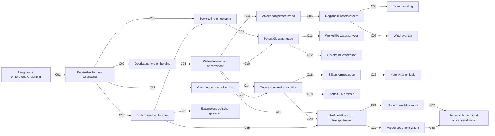

# Causaal netwerk off-site v0.3: volledige pijlcodering

**12 oktober 2026 · STATUS: ONTWERP VOOR EXPERTREVIEW · GEEN CANONIEKE ADMISSION**

Deze versie voert [ontwerpbesluit 80](80_besluit_volledige_causale_codering_v0_3.md) uit. Zij vervangt **voor de expertbespreking** de gecodeerde figuur in document 75 v0.2, maar wijzigt de canonieke F1–F6/O3-pathways niet.

## Leesinstructie

Iedere **causale** pijl draagt precies één code C01–C28. Die code verwijst naar precies één rij in de matrix. Een pijl beschrijft een te onderzoeken oorzakelijk mechanisme en bewijst niet dat de verandering altijd positief is. De code is een analyse-ID, geen empirische kwalificatie. De tekening is omvangrijk: toon haar in een presentatie op een afzonderlijke overzichtsdia en bespreek de drie deelgroepen daarna afzonderlijk.

**Bewijsstatus is niet met een lijnstijl gecodeerd**: daarvoor is de bronspecifieke beoordeling per matrixrij nodig. Daarmee vermijden we dat een mechanistisch plausibele pijl ten onrechte als nationaal gekwalificeerd wordt gezien.

## Volledig causaal netwerk

## Effectmatrix: iedere pijl exact één rij

| Code | Van → naar | Wat betekent de relatie? | Nog te toetsen | Voortouw | Aansluiting |
|---|---|---|---|---|---|
| C01 | Langdurige ondergrondverdichting → Poriënstructuur en weerstand | Berijding verandert de poriënstructuur en mechanische weerstand | Sterke fysische basis; omvang en persistentie per laag toetsen | Gezamenlijk | gemeenschappelijk |
| C02 | Poriënstructuur en weerstand → Doorlatendheid en berging | Poriënstructuur beïnvloedt doorlatendheid en waterberging | Bodemtype en poriënconnectiviteit bepalend | Ab | F1 |
| C03 | Doorlatendheid en berging → Waterstroming en bodemvocht | Hydraulische eigenschappen veranderen bodemvocht en stroming | Afhankelijk van neerslag, onderrand en drainage | Ab | F1 |
| C04 | Waterstroming en bodemvocht → Afvoer aan perceelsrand | Veranderde stroming beïnvloedt afvoer aan perceelsrand | Richting en timing kunnen verschillen | Ab | F1 |
| C05 | Afvoer aan perceelsrand → Regionaal watersysteem | Perceelsrandafvoer werkt door in regionaal watersysteem | Connectiviteit, berging en routing onvoldoende gekwalificeerd | Ab | F2 |
| C06 | Regionaal watersysteem → Extra bemaling | Watersysteemrespons kan extra bemaling veroorzaken | Feitelijke bediening en energie afzonderlijk toetsen | Ab | F3 |
| C07 | Regionaal watersysteem → Wateroverlast | Watersysteemrespons kan wateroverlast veroorzaken | Blootstelling en overschrijdingskans nodig | Ab | F4 |
| C08 | Poriënstructuur en weerstand → Beworteling en opname | Mechanische weerstand en poriën beïnvloeden beworteling | Diepte en gewasafhankelijk | Ab | O3 |
| C09 | Beworteling en opname → Potentiële watervraag | Beworteling en opname beïnvloeden potentiële watervraag | Potentiële vraag is geen geleverde hoeveelheid | Ab | O3 |
| C10 | Waterstroming en bodemvocht → Potentiële watervraag | Bodemvocht beïnvloedt potentiële watervraag | Weer en gewas bepalen teken en omvang | Ab | O3 |
| C11 | Potentiële watervraag → Werkelijke wateraanvoer | Potentiële vraag kan feitelijke wateraanvoer beïnvloeden | Gedrag, waterbeschikbaarheid en allocatie ontbreken | Ab | F5 |
| C12 | Potentiële watervraag → Onvervuld watertekort | Potentiële vraag kan onvervuld tekort veroorzaken | Afhankelijk van aanvoerbeperkingen en gedrag | Ab | F5 |
| C13 | Poriënstructuur en weerstand → Gastransport en beluchting | Poriënverandering beïnvloedt gastransport | Ondergrondstudies, bodemafhankelijk | Piet + tweede expert | kandidaat |
| C14 | Gastransport en beluchting → Zuurstof- en redoxcondities | Gastransport beïnvloedt zuurstofcondities | Vocht, temperatuur en diffusie bepalen respons | Piet + tweede expert | kandidaat |
| C15 | Waterstroming en bodemvocht → Zuurstof- en redoxcondities | Waterhuishouding beïnvloedt zuurstof en redox | Tijdsafhankelijke zuurstofcondities onbekend | Piet + tweede expert | kandidaat |
| C16 | Zuurstof- en redoxcondities → Stikstofomzettingen | Redox beïnvloedt stikstofomzettingen | N-beschikbaarheid en omzettingsroutes scheiden | Piet | kandidaat |
| C17 | Stikstofomzettingen → Netto N₂O-emissie | Stikstofomzettingen beïnvloeden netto N₂O-emissie | Productie en reductie tot N₂ apart | Piet + tweede expert | kandidaat |
| C18 | Zuurstof- en redoxcondities → Netto CH₄-emissie | Redox beïnvloedt netto CH₄-emissie | Productie én oxidatie bepalen nettoflux | Piet + tweede expert | kandidaat |
| C19 | Waterstroming en bodemvocht → Stofmobilisatie en transportroute | Waterstroming beïnvloedt mobilisatie en transportroute | Preferente stroming kan beide richtingen op veranderen | Piet / Wim | F6 |
| C20 | Zuurstof- en redoxcondities → Stofmobilisatie en transportroute | Redox kan mobilisatie en omzetting van stoffen beïnvloeden | Stof- en bodemafhankelijk, geen generieke factor | Piet | F6 |
| C21 | Stofmobilisatie en transportroute → N- en P-vracht in water | Transport bepaalt N- en P-vracht naar water | Flux × concentratie, retentie en route | Piet | F6 |
| C22 | Stofmobilisatie en transportroute → Middel-specifieke vracht | Transport bepaalt middel-specifieke vracht | Toepassing, sorptie, afbraak en timing | Wim | F6 |
| C23 | Poriënstructuur en weerstand → Bodemleven en functies | Verdichting beïnvloedt bodemleven en functies | Directe ondergrondgegevens beperkt | Bodemecoloog via Guido | kandidaat |
| C24 | Bodemleven en functies → Beworteling en opname | Bodemleven kan beworteling beïnvloeden | Mediator, dubbel tellen vermijden | Bodemecoloog | kandidaat |
| C25 | Bodemleven en functies → Stofmobilisatie en transportroute | Bodemleven kan stofmobilisatie en transportroutes beïnvloeden | Mechanisme en teken nog toetsen | Bodemecoloog / Piet | kandidaat |
| C26 | Bodemleven en functies → Externe ecologische gevolgen | Bodemecologische verandering kan externe gevolgen hebben | Externe receptor nog onvoldoende aangetoond | Bodemecoloog | kandidaat |
| C27 | N- en P-vracht in water → Ecologische toestand ontvangend water | N- en P-vracht kan ontvangend ecosysteem beïnvloeden | Ontvangend systeem en concentratie-respons nodig | Piet | F6 |
| C28 | Middel-specifieke vracht → Ecologische toestand ontvangend water | Gewasbeschermingsmiddelen kunnen ontvangend ecosysteem beïnvloeden | Blootstelling en toxiciteit stofspecifiek | Wim | F6 |

## Conversie oude C-codes naar v0.3

| Oude code v0.2 | Nieuwe code(s) v0.3 | Toelichting |
|---|---|---|
| C01 | C01 | Oude bundel waar nodig uitgesplitst |
| C02 | C02 | Oude bundel waar nodig uitgesplitst |
| C03 | C03–C04 | Oude bundel waar nodig uitgesplitst |
| C04 | C05 | Oude bundel waar nodig uitgesplitst |
| C05 | C06–C07 | Oude bundel waar nodig uitgesplitst |
| C06 | C09–C10 | Oude bundel waar nodig uitgesplitst |
| C07 | C11–C12 | Oude bundel waar nodig uitgesplitst |
| C08 | C13–C15 | Oude bundel waar nodig uitgesplitst |
| C09 | C16–C18 | Oude bundel waar nodig uitgesplitst |
| C10 | C19–C21 en C27 | Oude bundel waar nodig uitgesplitst |
| C11 | C19 en C22 en C28 | Oude bundel waar nodig uitgesplitst |
| C12 | C23 | Oude bundel waar nodig uitgesplitst |
| C13 | C26 | Oude bundel waar nodig uitgesplitst |
| C14 | Geen C-code: waarderingslaag | Geen fysisch causaal proces; apart rapportagecontract |

De migratietabel is een **inhoudelijke crosswalk**, niet altijd een één-op-één hernummering. Oude codes in presentaties of notities moeten expliciet als v0.2 worden aangeduid totdat ze zijn aangepast.

## Rapportage en maatschappelijke waardering: bewust géén C-pijlen

De eindpunten zijn: extra bemaling, wateroverlast, feitelijke wateraanvoer, onvervuld tekort, netto N₂O, netto CH₄, N/P-vracht, gewasbeschermingsmiddelenvracht, externe ecologische toestand en mogelijke overige externe ecologische gevolgen.

**Voor ieder eindpunt afzonderlijk** doorlopen we de rapportagestappen R1–R4:
- **R1:** is het effect fysiek aantoonbaar en toe te schrijven aan ondergrondverdichting?
- **R2:** waar en bij wie ontstaat het maatschappelijke of ecologische gevolg?
- **R3:** is monetarisering verantwoord, en welke schadefunctie/prijsjaar/perspectief geldt?
- **R4:** welke fysieke, kwalitatieve en onbekende effecten blijven naast de eurobandbreedte zichtbaar, en waar dreigt dubbeltelling?

R1–R4 zijn **beslisvragen**, geen extra fysische pijlen en geen nieuwe officiële pathway-ID's.

## Belangrijke grenzen

- Een water- of stofstroom is nog geen maatschappelijke schade.
- Netto N₂O en CH₄ worden afzonderlijk behandeld; hun biogeochemische routes zijn niet identiek.
- Bodemecologie kan lokaal zelfstandig relevant zijn, ook als C26 nog niet is bewezen als externe schade.
- Deze figuur heeft geen kwantitatieve transferfactoren of schadecoëfficiënten toegelaten.
- De oude hoofdcategorieën uit het expertverslag blijven als zes werksporen bestaan.

## Controle en acceptatie

- Causale pijlen: **28**.
- Unieke codes: **28**.
- Iedere pijl heeft één unieke code en één matrixrij.
- Alle in de figuur gebruikte codes komen in de matrix voor.
- De v0.2 → v0.3 crosswalk is opgenomen.
- R1–R4 zijn afzonderlijke rapportagevragen, niet vermomde causale relaties.

**Open:** inhoudelijke expertbeoordeling van elke pijl, bronkwalificatie en leesbaarheid van de uiteindelijke rendering. Eerst daarna de PowerPoint bijwerken.
