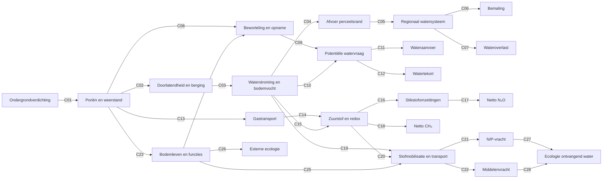

# Causale netwerkfiguur off-site v0.3 (presentatieversie)

**Datum:** 12 oktober 2026. **Status:** DISCUSSION_DRAFT. Deze figuur is de presentatie-uitwerking van [de volledige v0.3 effectmatrix](81_causaal_netwerk_volledig_gecodeerd_v0_3.md). Alle 28 causale pijlen en hun C-codes zijn inhoudelijk gelijk aan document 81. De nodebenamingen zijn uitsluitend ingekort voor leesbaarheid op een dia. Er zijn geen nieuwe wetenschappelijke relaties of schadefactoren toegevoegd.

## Volledige figuur

## Hoe lees je deze figuur?

Begin links bij langdurige ondergrondverdichting. De verbindingen beschrijven mogelijke veranderingen in bodemstructuur, waterhuishouding, gastransport en bodemleven, gevolgd door effecten buiten het perceel. **Een C-code verwijst naar precies één causale verbinding in de matrix van document 81.** De pijlen tonen geen vaststaand teken of grootte van een effect.

### Uitleg per groep

| Codes | Onderwerp | Belangrijkste onderscheid |
|---|---|---|
| C01–C07 | Bodemstructuur, afvoer en wateroverlast | Perceelsafvoer is niet hetzelfde als regionale overlast of extra bemaling |
| C08–C12 | Beworteling en watervraag | Potentiële behoefte is niet hetzelfde als werkelijke aanvoer of tekort |
| C13–C18 | Gastransport en emissies | N₂O en CH₄ hebben verschillende omzettingsprocessen |
| C19–C22 | Transport van stoffen | Waterstroming alleen bepaalt geen N/P- of middelenvracht |
| C23–C26 | Bodemecologie | Lokale ecologische verandering is niet automatisch een afzonderlijk off-site-effect |
| C27–C28 | Ontvangend water | Stofvracht is niet automatisch ecologische schade |

## Van fysiek effect naar maatschappelijke gevolgen

De rapportage- en waarderingsvragen **R1–R4** zijn bewust geen causale C-pijlen:

- **R1:** is het fysieke effect aantoonbaar en toe te schrijven aan ondergrondverdichting?
- **R2:** wie of wat ondervindt het gevolg?
- **R3:** is monetarisering verantwoord?
- **R4:** welke fysieke, kwalitatieve en nog onbekende gevolgen blijven zichtbaar, en waar dreigt dubbeltelling?

## Status en bronnen

Dit is een conceptuele figuur, geen gekwalificeerd causaal rekenmodel. Zie [document 81](81_causaal_netwerk_volledig_gecodeerd_v0_3.md) voor de volledige 28-regelige effectmatrix, bewijsbeperkingen en de vertaaltabel vanaf v0.2. Zie [de kritische review](82_kritische_review_causaal_netwerk_v0_3.md) voor openstaande inhoudelijke punten.

De PowerPointversie gebruikt dezelfde pijlen en codes, maar is visueel geordend voor presentatie. De WUR-presentatie en het projectlogo zijn afzonderlijke presentatiebestanden; deze Markdown is de bewerkbare bron voor de netwerkfiguur.

## Toelichting op de bestaande onderzoeksroutes in Git

De **C-codes** (C01–C28) benoemen afzonderlijke causale verbindingen in de figuur. De **F- en O-codes** verwijzen naar de bestaande indeling van het bodemverdichtingsonderzoek in Git; ze zijn geen bewijs dat een relatie al wetenschappelijk is aangetoond. **F1** betreft perceelsafvoer, **F2** overdracht naar het regionale watersysteem, **F3** bemaling, **F4** wateroverlast en schade, **F5** wateraanvoer, **F6** waterkwaliteit (nutriënten en gewasbeschermingsmiddelen), en **O3** de onsite-route voor droogtegevoeligheid en potentiële watervraag. **Kandidaat** betekent dat het voorgestelde onderdeel nog niet als officiële onderzoeksroute is opgenomen. **Gemeenschappelijk** verwijst naar de bodemfysische basis die meerdere routes delen.

Deze indeling is gebaseerd op de bestaande projectmatrix [document 49](49_project_effect_pathway_matrix_v0_1.md). Voor de inhoudelijke beoordeling van een C-code is de bijbehorende causale relatie belangrijker dan de interne routecode.

## Volledige uitleg per causale verbinding (C01–C28)

De onderstaande toelichtingen volgen letterlijk de **inhoudelijke relaties en onzekerheidsgrenzen** van de effectmatrix in document 81. Ze zijn geen afzonderlijk gevalideerde claims. De kolom 'Wat nog moet worden getoetst' geeft aan waar het bestaande onderzoek nog onvoldoende specifiek of kwantitatief is.

### Wateroverlast en watersysteem

| Code | Van → naar | Betekenis | Wat nog moet worden getoetst | Voortouw | Bestaande onderzoeksroute (Git) |
|---|---|---|---|---|---|
| C01 | Langdurige ondergrondverdichting → Poriënstructuur en weerstand | Berijding verandert de poriënstructuur en mechanische weerstand | Sterke fysische basis; omvang en persistentie per laag toetsen | Gezamenlijk | gemeenschappelijk |
| C02 | Poriënstructuur en weerstand → Doorlatendheid en berging | Poriënstructuur beïnvloedt doorlatendheid en waterberging | Bodemtype en poriënconnectiviteit bepalend | Ab | F1 |
| C03 | Doorlatendheid en berging → Waterstroming en bodemvocht | Hydraulische eigenschappen veranderen bodemvocht en stroming | Afhankelijk van neerslag, onderrand en drainage | Ab | F1 |
| C04 | Waterstroming en bodemvocht → Afvoer aan perceelsrand | Veranderde stroming beïnvloedt afvoer aan perceelsrand | Richting en timing kunnen verschillen | Ab | F1 |
| C05 | Afvoer aan perceelsrand → Regionaal watersysteem | Perceelsrandafvoer werkt door in regionaal watersysteem | Connectiviteit, berging en routing onvoldoende gekwalificeerd | Ab | F2 |
| C06 | Regionaal watersysteem → Extra bemaling | Watersysteemrespons kan extra bemaling veroorzaken | Feitelijke bediening en energie afzonderlijk toetsen | Ab | F3 |
| C07 | Regionaal watersysteem → Wateroverlast | Watersysteemrespons kan wateroverlast veroorzaken | Blootstelling en overschrijdingskans nodig | Ab | F4 |

### Beworteling en watervraag

| Code | Van → naar | Betekenis | Wat nog moet worden getoetst | Voortouw | Bestaande onderzoeksroute (Git) |
|---|---|---|---|---|---|
| C08 | Poriënstructuur en weerstand → Beworteling en opname | Mechanische weerstand en poriën beïnvloeden beworteling | Diepte en gewasafhankelijk | Ab | O3 |
| C09 | Beworteling en opname → Potentiële watervraag | Beworteling en opname beïnvloeden potentiële watervraag | Potentiële vraag is geen geleverde hoeveelheid | Ab | O3 |
| C10 | Waterstroming en bodemvocht → Potentiële watervraag | Bodemvocht beïnvloedt potentiële watervraag | Weer en gewas bepalen teken en omvang | Ab | O3 |
| C11 | Potentiële watervraag → Werkelijke wateraanvoer | Potentiële vraag kan feitelijke wateraanvoer beïnvloeden | Gedrag, waterbeschikbaarheid en allocatie ontbreken | Ab | F5 |
| C12 | Potentiële watervraag → Onvervuld watertekort | Potentiële vraag kan onvervuld tekort veroorzaken | Afhankelijk van aanvoerbeperkingen en gedrag | Ab | F5 |

### Gastransport en broeikasgassen

| Code | Van → naar | Betekenis | Wat nog moet worden getoetst | Voortouw | Bestaande onderzoeksroute (Git) |
|---|---|---|---|---|---|
| C13 | Poriënstructuur en weerstand → Gastransport en beluchting | Poriënverandering beïnvloedt gastransport | Ondergrondstudies, bodemafhankelijk | Piet + tweede expert | kandidaat |
| C14 | Gastransport en beluchting → Zuurstof- en redoxcondities | Gastransport beïnvloedt zuurstofcondities | Vocht, temperatuur en diffusie bepalen respons | Piet + tweede expert | kandidaat |
| C15 | Waterstroming en bodemvocht → Zuurstof- en redoxcondities | Waterhuishouding beïnvloedt zuurstof en redox | Tijdsafhankelijke zuurstofcondities onbekend | Piet + tweede expert | kandidaat |
| C16 | Zuurstof- en redoxcondities → Stikstofomzettingen | Redox beïnvloedt stikstofomzettingen | N-beschikbaarheid en omzettingsroutes scheiden | Piet | kandidaat |
| C17 | Stikstofomzettingen → Netto N₂O-emissie | Stikstofomzettingen beïnvloeden netto N₂O-emissie | Productie en reductie tot N₂ apart | Piet + tweede expert | kandidaat |
| C18 | Zuurstof- en redoxcondities → Netto CH₄-emissie | Redox beïnvloedt netto CH₄-emissie | Productie én oxidatie bepalen nettoflux | Piet + tweede expert | kandidaat |

### Stoftransport en waterkwaliteit

| Code | Van → naar | Betekenis | Wat nog moet worden getoetst | Voortouw | Bestaande onderzoeksroute (Git) |
|---|---|---|---|---|---|
| C19 | Waterstroming en bodemvocht → Stofmobilisatie en transportroute | Waterstroming beïnvloedt mobilisatie en transportroute | Preferente stroming kan beide richtingen op veranderen | Piet / Wim | F6 |
| C20 | Zuurstof- en redoxcondities → Stofmobilisatie en transportroute | Redox kan mobilisatie en omzetting van stoffen beïnvloeden | Stof- en bodemafhankelijk, geen generieke factor | Piet | F6 |
| C21 | Stofmobilisatie en transportroute → N- en P-vracht in water | Transport bepaalt N- en P-vracht naar water | Flux × concentratie, retentie en route | Piet | F6 |
| C22 | Stofmobilisatie en transportroute → Middel-specifieke vracht | Transport bepaalt middel-specifieke vracht | Toepassing, sorptie, afbraak en timing | Wim | F6 |

### Bodemecologie

| Code | Van → naar | Betekenis | Wat nog moet worden getoetst | Voortouw | Bestaande onderzoeksroute (Git) |
|---|---|---|---|---|---|
| C23 | Poriënstructuur en weerstand → Bodemleven en functies | Verdichting beïnvloedt bodemleven en functies | Directe ondergrondgegevens beperkt | Bodemecoloog via Guido | kandidaat |
| C24 | Bodemleven en functies → Beworteling en opname | Bodemleven kan beworteling beïnvloeden | Mediator, dubbel tellen vermijden | Bodemecoloog | kandidaat |
| C25 | Bodemleven en functies → Stofmobilisatie en transportroute | Bodemleven kan stofmobilisatie en transportroutes beïnvloeden | Mechanisme en teken nog toetsen | Bodemecoloog / Piet | kandidaat |
| C26 | Bodemleven en functies → Externe ecologische gevolgen | Bodemecologische verandering kan externe gevolgen hebben | Externe receptor nog onvoldoende aangetoond | Bodemecoloog | kandidaat |

### Ontvangend oppervlaktewater

| Code | Van → naar | Betekenis | Wat nog moet worden getoetst | Voortouw | Bestaande onderzoeksroute (Git) |
|---|---|---|---|---|---|
| C27 | N- en P-vracht in water → Ecologische toestand ontvangend water | N- en P-vracht kan ontvangend ecosysteem beïnvloeden | Ontvangend systeem en concentratie-respons nodig | Piet | F6 |
| C28 | Middel-specifieke vracht → Ecologische toestand ontvangend water | Gewasbeschermingsmiddelen kunnen ontvangend ecosysteem beïnvloeden | Blootstelling en toxiciteit stofspecifiek | Wim | F6 |

### Belangrijke interpretatiegrenzen

- **C06 en C07** zijn twee verschillende mogelijke gevolgen van het watersysteem. Extra bemalingskosten zijn niet hetzelfde als overstromingsschade.
- **C11 en C12** onderscheiden werkelijke wateraanvoer van onvervuld tekort; potentiële behoefte is geen feitelijke levering.
- **C17 en C18** zijn afzonderlijke netto emissieroutes. CH₄ wordt niet uit stikstofomzettingen afgeleid; productie en oxidatie moeten worden onderscheiden.
- **C20** geldt niet automatisch voor iedere stof. Redoxinvloed is stof- en bodemafhankelijk.
- **C24 en C25** beschrijven bodemleven als tussenschakel in andere effecten. Die mogen niet automatisch als extra zelfstandige schade worden opgeteld.
- **C26** is een nog te toetsen hypothese over een afzonderlijk gevolg buiten het perceel.
- **C27 en C28** vereisen aanvullende informatie over het ontvangende water en blootstelling voordat een ecologische schadeclaim verantwoord is.

**Bron en versiebeheer:** de volledige relatiebeschrijvingen, onzekerheden, trekkers en projectroutes zijn overgenomen uit [document 81](81_causaal_netwerk_volledig_gecodeerd_v0_3.md), versie 0.3. Bij toekomstige hercodering moeten de figuur en beide tabellen gezamenlijk worden bijgewerkt.
