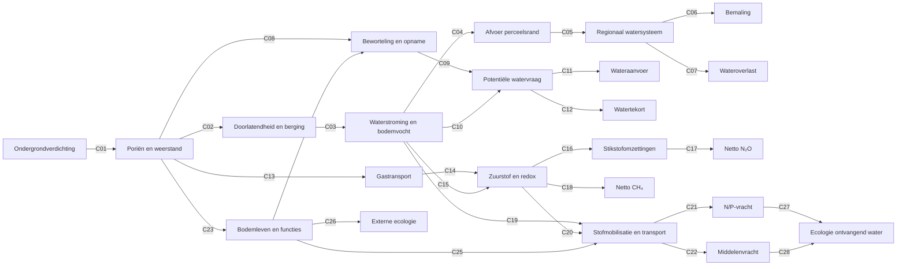

# Causale netwerkfiguur off-site v0.3 (presentatieversie)

**Datum:** 12 oktober 2026. **Status:** DISCUSSION_DRAFT. Deze figuur is de presentatie-uitwerking van [de volledige v0.3 effectmatrix](81_causaal_netwerk_volledig_gecodeerd_v0_3.md). Alle 28 causale pijlen en hun C-codes zijn inhoudelijk gelijk aan document 81. De nodebenamingen zijn uitsluitend ingekort voor leesbaarheid op een dia. Er zijn geen nieuwe wetenschappelijke relaties of schadefactoren toegevoegd.

## Volledige figuur

## Hoe lees je deze figuur?

Begin links bij langdurige ondergrondverdichting. De verbindingen beschrijven mogelijke veranderingen in bodemstructuur, waterhuishouding, gastransport en bodemleven, gevolgd door effecten buiten het perceel. **Een C-code verwijst naar precies één causale verbinding in de matrix van document 81.** De pijlen tonen geen vaststaand teken of grootte van een effect.

### Uitleg per groep

| Codes | Onderwerp | Belangrijkste onderscheid |
|---|---|---|
| C01–C07 | Bodemstructuur, afvoer en wateroverlast | Perceelsafvoer is niet hetzelfde als regionale overlast of extra bemaling |
| C08–C12 | Beworteling en watervraag | Potentiële behoefte is niet hetzelfde als werkelijke aanvoer of tekort |
| C13–C18 | Gastransport en emissies | N₂O en CH₄ hebben verschillende omzettingsprocessen |
| C19–C22 | Transport van stoffen | Waterstroming alleen bepaalt geen N/P- of middelenvracht |
| C23–C26 | Bodemecologie | Lokale ecologische verandering is niet automatisch een afzonderlijk off-site-effect |
| C27–C28 | Ontvangend water | Stofvracht is niet automatisch ecologische schade |

## Van fysiek effect naar maatschappelijke gevolgen

De rapportage- en waarderingsvragen **R1–R4** zijn bewust geen causale C-pijlen:

- **R1:** is het fysieke effect aantoonbaar en toe te schrijven aan ondergrondverdichting?
- **R2:** wie of wat ondervindt het gevolg?
- **R3:** is monetarisering verantwoord?
- **R4:** welke fysieke, kwalitatieve en nog onbekende gevolgen blijven zichtbaar, en waar dreigt dubbeltelling?

## Status en bronnen

Dit is een conceptuele figuur, geen gekwalificeerd causaal rekenmodel. Zie [document 81](81_causaal_netwerk_volledig_gecodeerd_v0_3.md) voor de volledige 28-regelige effectmatrix, bewijsbeperkingen en de vertaaltabel vanaf v0.2. Zie [de kritische review](82_kritische_review_causaal_netwerk_v0_3.md) voor openstaande inhoudelijke punten.

De PowerPointversie gebruikt dezelfde pijlen en codes, maar is visueel geordend voor presentatie. De WUR-presentatie en het projectlogo zijn afzonderlijke presentatiebestanden; deze Markdown is de bewerkbare bron voor de netwerkfiguur.
