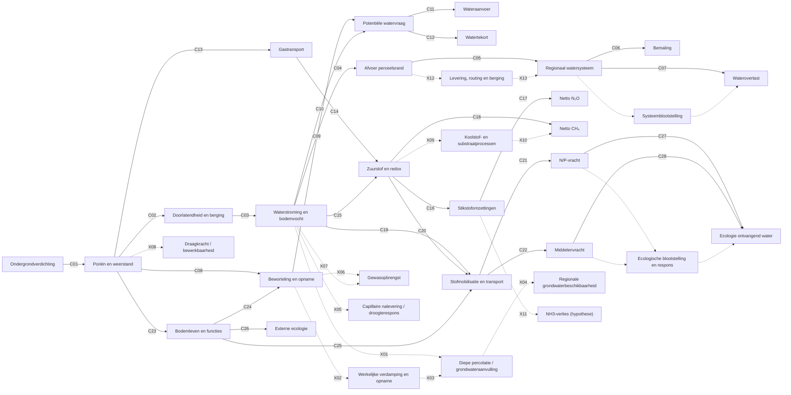

# Causaal netwerk ondergrondverdichting v0.4, na expertenoverleg

**12 oktober 2026 | DISCUSSION_DRAFT | geen gevalideerd rekenmodel of canonieke admission.**

Deze versie bouwt voort op [figuur v0.3](83_causaal_netwerk_presentatiefiguur_v0_3.md), [effectmatrix 81](81_causaal_netwerk_volledig_gecodeerd_v0_3.md) en [review 82](82_kritische_review_causaal_netwerk_v0_3.md). De bestaande **C01–C28 blijven onveranderd**. Alle X-codes zijn nieuwe kandidaatrelaties die eerst deskundig beoordeeld moeten worden. De figuur toont geen vaste richting of grootte van effecten.

## Integrale causale figuur

**Legenda:** C01–C28 zijn de bestaande conceptuele causale verbindingen; X01–X13 zijn gestippelde onderzoeksvoorstellen. Gestippelde ongecodeerde pijlen concretiseren de receptorstappen maar zijn geen geaccepteerde causale relaties. De bronmatrix van v0.3 blijft ongewijzigd.

## Nieuwe relaties naar aanleiding van de expertbespreking

| Code | Relatie | Interpretatie en kennislacune |
|---|---|---|
| X01 | Waterstroming → diepe percolatie / grondwateraanvulling | Diepe percolatie is niet gelijk aan netto grondwateraanvulling; drainage en onderrand toetsen. |
| X02 | Beworteling → werkelijke verdamping | Worteldiepte kan opname beïnvloeden, afhankelijk van weer en bodem. |
| X03 | Verdamping → diepe percolatie | Minder opname kan percolatie vergroten, maar belemmerde doorlatendheid kan dit tegengaan. |
| X04 | Aanvulling → regionale beschikbaarheid | Alleen extern gevolg bij aantoonbare doorwerking naar gebruikers of ecosystemen. |
| X05 | Bodemvocht → capillaire nalevering | Mogelijke baat én nadeel, afhankelijk van omstandigheden. |
| X06 | Beworteling → opbrengst | Verklarende on-site route, geen extra schade bovenop totale empirische opbrengstderving. |
| X07 | Bodemvocht → opbrengst | Samengevouwen relatie via onder meer water- en zuurstofstress. |
| X08 | Poriënstructuur → draagkracht / werkbaarheid | Potentieel gunstig of ongunstig; meer berijding kan verdichting versterken. |
| X09 | Redox → koolstof-/substraatprocessen | Expliciteert deel van samengevouwen C18. |
| X10 | Koolstof/substraat → netto CH4 | Productie en oxidatie gescheiden beschouwen. |
| X11 | Stikstofomzettingen → NH3 | Onzekere, mogelijk onjuiste route: pH, ammonium, toediening en temperatuur zijn mede bepalend; geen admission. |
| X12 | Perceelsrandafvoer → netwerklevering | Splitst C05 uit in overdracht, routing en berging. |
| X13 | Netwerklevering → regionale respons | Uitwerking van C05, niet cumulatief met bestaande C05 waarderen. |

X09–X10 verfijnen C18, X12–X13 verfijnen C05. Bij formele toelating moet de oorspronkelijke C-matrix worden aangepast. Nieuwe relaties zijn **geen additionele onafhankelijke schadefactoren**.

## De zes inhoudelijke effectcategorieën

### 1. Wateroverlast en bemaling
C01–C07 en X12–X13. De verdichte laag kan hydraulische eigenschappen, afvoerhoeveelheid en afvoertiming veranderen. Afvoer aan de perceelsrand is niet hetzelfde als water dat een gemaal of kwetsbaar gebied bereikt. Beoordeel netwerkconnectiviteit, berging, drainage, route, capaciteit en bediening; bemalingskosten en overstromingsschade zijn verschillende mogelijk overlappende eindpunten. Tollebeek is hooguit toetslocatie voor één systeemtype.

### 2. Wateraanvoer en beschikbaarheid
C08–C12 en X01–X05. Beworteling en hydraulische eigenschappen beïnvloeden verdamping, watertekort, eventuele irrigatievraag en diepe percolatie. Potentiële vraag is geen werkelijke aanvoer. Minder wortelopname leidt niet automatisch tot meer grondwateraanvulling. Een sluitende waterbalans, onderrand en relevante gebruikers zijn vereist. Mogelijke positieve capillaire effecten zijn slechts hypothesen.

### 3. Broeikasgasemissies
C13–C18, X09–X10. Bodemvocht, zuurstof, redox, substraat en microbiële omzettingen beïnvloeden N2O en CH4 via verschillende processen. Voor N2O productie en reductie tot N2 onderscheiden; voor CH4 productie en oxidatie. NH3 (X11) is geen broeikasgas en de directe relatie met ondergrondverdichting is nog onvoldoende onderbouwd.

### 4. Nutriënten
C19–C21 en C27. Verdichting kan verticale uitspoeling verminderen terwijl lateraal transport of emissies veranderen. Flux, concentratie, route, retentie en respons van ontvangend water moeten afzonderlijk worden beoordeeld. Minder nitraatuitspoeling betekent niet automatisch minder totale milieuschade.

### 5. Gewasbeschermingsmiddelen
C19, C22 en C28. Veranderingen in oppervlakkige afstroming, drainage of preferente stroming kunnen stoffen vervoeren. De belasting hangt bovendien af van toepassing, timing, sorptie, afbraak en middel-specifieke toxiciteit. Alleen meer runoff bewijst geen hogere ecologische schade.

### 6. Bodemleven en biodiversiteit
C23–C26, C27–C28. Bodemleven beïnvloedt onder meer beworteling en stofomzetting. Lokale bodemecologische effecten kunnen relevant zijn zonder aantoonbaar extern schade-eindpunt. C26 vergt identificatie van een onafhankelijke receptor. Ecologische effecten blijven expliciet vermeld, ook als geen betrouwbare euro-omrekening mogelijk is.

## Gezamenlijk fysisch netwerk, verschillende berekeningsroutes

**On-site:** gebruik bodemtype × landgebruik × verdichtingsklasse × relevante arealen en empirisch onderbouwde opbrengstdervingsbandbreedtes per gewas, met representatieve bedrijfstypen en bouwplannen. De totale opbrengstderving wordt niet kunstmatig uitgesplitst in procenten per proces. Een SWAP-achtige berekening kan onafhankelijk plausibiliteit toetsen maar is niet de primaire empirische schadetoerekening.

**Off-site:** van proces naar fysiek effect, levering aan ontvangend systeem, receptorrespons en vervolgens eventuele maatschappelijke schade. Gebruik directe gegevens als die afdoende zijn; modelleer alleen gericht bij aantoonbare informatiewinst. On-site is niet gelijk aan privaat en off-site niet gelijk aan publiek: registreer ruimte en schadeontvanger afzonderlijk.

**R1–R4, buiten het causale netwerk:** R1 is bewijs en toerekening; R2 is actor, receptor en schaal; R3 is economische waardering, prijsjaar en perspectief; R4 zijn niet-gemonetariseerde effecten en dubbeltelling. Feitelijke klimaatschade, gemaakte kosten en hypothetisch vermeden reductiemaatregelen mogen niet zonder consistent scenario samen worden opgeteld. Niet halen van een KRW-doel levert op zichzelf nog geen schadebedrag.

## Referentie, data en toekomstscenario's

De eerste raming gaat over **jaarlijkse schade van de huidige ondergrondverdichting**, vergeleken met een vergelijkbare bodem zonder schadelijke antropogene verdichting. Dat is niet automatisch de natuurlijke ongestoorde situatie of een realiseerbare herstelbaat. De vergadering noemt circa 2.000 meetpunten (2024), waarvan sommige eerder in 2018 zijn gemeten: representativiteit, diepte, dichtheidsklassen en steekproefontwerp verifiëren. De genoemde 1,2/1,4/1,7 g/cm3 zijn illustratieve waarden en niet universele criteria. Veen vraagt een eigen referentie en classificatie.

Bestaande bodemfysische modelinvoer kan historische verdichting bevatten. Voeg geen extra verdichte laag toe zonder de referentieprofielen te toetsen. Houd weer, bodemtype, landgebruik en hydrologische randvoorwaarden in de vergelijking gelijk voor zover mogelijk. Huidige schade, toekomstige trend en effect van preventie/herstel zijn aparte scenario's.

## Van links naar rechts en van rechts naar links

Mechanistisch redeneren begint bij ondergrondverdichting en zoekt via processen naar maatschappelijke gevolgen. Schadegericht terugredeneren begint bij een bestaand probleem (bijvoorbeeld overstroming) en onderzoekt welk deel ervan **causaal** aan verdichting toe te rekenen is. Grootte van bestaande nationale problemen is geen bewijs van verdichtingsaandeel. Onderzoek in Graves/Defra SP1606 per schadepost welke schakels berusten op meting, model of expert judgment.

Relevantie is meer dan monetariseerbaarheid: kijk ook naar fysieke en ecologische omvang, causaliteit, bewijs, beleidsbetekenis en haalbare informatiewinst. Indien kwantificering niet verantwoord is, rapporteer een duidelijke kennislacune in plaats van een fictieve nul of puntwaarde.

## Werkafspraken en te nemen besluiten

1. Per effectcategorie een kort narratief, klein deelschema, kruisverbanden, mogelijke baten en schadeontvangers.
2. Alle X-relaties beoordelen, met prioriteit voor C05, C09–C12, C18, C20 en C26–C28; hernummer of vervang bestaande C-relaties niet stilzwijgend.
3. Koppeling tussen verdichtingsmetingen en hydraulische parameters onderzoeken, inclusief de referentie in bestaande BOVEC-/SWAP-invoer.
4. Empirische on-site opbrengsteffecten naar bodemtype, gewas, ernst en bedrijfstype kwalificeren.
5. Milieueconomische deskundige betrekken voor waarderingsgrondslagen en overlapcontroles.
6. Graves/Defra-methodiek onderzoeken, te beginnen met toerekening van overstromingsschade.
7. Veencriteria, huidige kaart en de deels herhaalde metingen nader beoordelen.
8. In 2026 effectbeschrijvingen en kennisleemtes afmaken; een berekeningsstrategie voor 2027 voorbereiden.

**Status en versiebeheer:** dit document is een voorstel, geen vervanging van de goedgekeurde v0.3-matrix. Bij aanvaarding van nieuwe pijlen dienen figuur, effectmatrix, review en crosswalk gezamenlijk te worden herzien.

---

## Volledige uitleg van C01–C28 (ongewijzigd uit v0.3)

## Volledige uitleg per causale verbinding (C01–C28)

De onderstaande toelichtingen volgen letterlijk de **inhoudelijke relaties en onzekerheidsgrenzen** van de effectmatrix in document 81. Ze zijn geen afzonderlijk gevalideerde claims. De kolom 'Wat nog moet worden getoetst' geeft aan waar het bestaande onderzoek nog onvoldoende specifiek of kwantitatief is.

### Wateroverlast en watersysteem

| Code | Van → naar | Betekenis | Wat nog moet worden getoetst | Voortouw | Bestaande onderzoeksroute (Git) |
|---|---|---|---|---|---|
| C01 | Langdurige ondergrondverdichting → Poriënstructuur en weerstand | Berijding verandert de poriënstructuur en mechanische weerstand | Sterke fysische basis; omvang en persistentie per laag toetsen | Gezamenlijk | gemeenschappelijk |
| C02 | Poriënstructuur en weerstand → Doorlatendheid en berging | Poriënstructuur beïnvloedt doorlatendheid en waterberging | Bodemtype en poriënconnectiviteit bepalend | Ab | F1 |
| C03 | Doorlatendheid en berging → Waterstroming en bodemvocht | Hydraulische eigenschappen veranderen bodemvocht en stroming | Afhankelijk van neerslag, onderrand en drainage | Ab | F1 |
| C04 | Waterstroming en bodemvocht → Afvoer aan perceelsrand | Veranderde stroming beïnvloedt afvoer aan perceelsrand | Richting en timing kunnen verschillen | Ab | F1 |
| C05 | Afvoer aan perceelsrand → Regionaal watersysteem | Perceelsrandafvoer werkt door in regionaal watersysteem | Connectiviteit, berging en routing onvoldoende gekwalificeerd | Ab | F2 |
| C06 | Regionaal watersysteem → Extra bemaling | Watersysteemrespons kan extra bemaling veroorzaken | Feitelijke bediening en energie afzonderlijk toetsen | Ab | F3 |
| C07 | Regionaal watersysteem → Wateroverlast | Watersysteemrespons kan wateroverlast veroorzaken | Blootstelling en overschrijdingskans nodig | Ab | F4 |

### Beworteling en watervraag

| Code | Van → naar | Betekenis | Wat nog moet worden getoetst | Voortouw | Bestaande onderzoeksroute (Git) |
|---|---|---|---|---|---|
| C08 | Poriënstructuur en weerstand → Beworteling en opname | Mechanische weerstand en poriën beïnvloeden beworteling | Diepte en gewasafhankelijk | Ab | O3 |
| C09 | Beworteling en opname → Potentiële watervraag | Beworteling en opname beïnvloeden potentiële watervraag | Potentiële vraag is geen geleverde hoeveelheid | Ab | O3 |
| C10 | Waterstroming en bodemvocht → Potentiële watervraag | Bodemvocht beïnvloedt potentiële watervraag | Weer en gewas bepalen teken en omvang | Ab | O3 |
| C11 | Potentiële watervraag → Werkelijke wateraanvoer | Potentiële vraag kan feitelijke wateraanvoer beïnvloeden | Gedrag, waterbeschikbaarheid en allocatie ontbreken | Ab | F5 |
| C12 | Potentiële watervraag → Onvervuld watertekort | Potentiële vraag kan onvervuld tekort veroorzaken | Afhankelijk van aanvoerbeperkingen en gedrag | Ab | F5 |

### Gastransport en broeikasgassen

| Code | Van → naar | Betekenis | Wat nog moet worden getoetst | Voortouw | Bestaande onderzoeksroute (Git) |
|---|---|---|---|---|---|
| C13 | Poriënstructuur en weerstand → Gastransport en beluchting | Poriënverandering beïnvloedt gastransport | Ondergrondstudies, bodemafhankelijk | Piet + tweede expert | kandidaat |
| C14 | Gastransport en beluchting → Zuurstof- en redoxcondities | Gastransport beïnvloedt zuurstofcondities | Vocht, temperatuur en diffusie bepalen respons | Piet + tweede expert | kandidaat |
| C15 | Waterstroming en bodemvocht → Zuurstof- en redoxcondities | Waterhuishouding beïnvloedt zuurstof en redox | Tijdsafhankelijke zuurstofcondities onbekend | Piet + tweede expert | kandidaat |
| C16 | Zuurstof- en redoxcondities → Stikstofomzettingen | Redox beïnvloedt stikstofomzettingen | N-beschikbaarheid en omzettingsroutes scheiden | Piet | kandidaat |
| C17 | Stikstofomzettingen → Netto N₂O-emissie | Stikstofomzettingen beïnvloeden netto N₂O-emissie | Productie en reductie tot N₂ apart | Piet + tweede expert | kandidaat |
| C18 | Zuurstof- en redoxcondities → Netto CH₄-emissie | Redox beïnvloedt netto CH₄-emissie | Productie én oxidatie bepalen nettoflux | Piet + tweede expert | kandidaat |

### Stoftransport en waterkwaliteit

| Code | Van → naar | Betekenis | Wat nog moet worden getoetst | Voortouw | Bestaande onderzoeksroute (Git) |
|---|---|---|---|---|---|
| C19 | Waterstroming en bodemvocht → Stofmobilisatie en transportroute | Waterstroming beïnvloedt mobilisatie en transportroute | Preferente stroming kan beide richtingen op veranderen | Piet / Wim | F6 |
| C20 | Zuurstof- en redoxcondities → Stofmobilisatie en transportroute | Redox kan mobilisatie en omzetting van stoffen beïnvloeden | Stof- en bodemafhankelijk, geen generieke factor | Piet | F6 |
| C21 | Stofmobilisatie en transportroute → N- en P-vracht in water | Transport bepaalt N- en P-vracht naar water | Flux × concentratie, retentie en route | Piet | F6 |
| C22 | Stofmobilisatie en transportroute → Middel-specifieke vracht | Transport bepaalt middel-specifieke vracht | Toepassing, sorptie, afbraak en timing | Wim | F6 |

### Bodemecologie

| Code | Van → naar | Betekenis | Wat nog moet worden getoetst | Voortouw | Bestaande onderzoeksroute (Git) |
|---|---|---|---|---|---|
| C23 | Poriënstructuur en weerstand → Bodemleven en functies | Verdichting beïnvloedt bodemleven en functies | Directe ondergrondgegevens beperkt | Bodemecoloog via Guido | kandidaat |
| C24 | Bodemleven en functies → Beworteling en opname | Bodemleven kan beworteling beïnvloeden | Mediator, dubbel tellen vermijden | Bodemecoloog | kandidaat |
| C25 | Bodemleven en functies → Stofmobilisatie en transportroute | Bodemleven kan stofmobilisatie en transportroutes beïnvloeden | Mechanisme en teken nog toetsen | Bodemecoloog / Piet | kandidaat |
| C26 | Bodemleven en functies → Externe ecologische gevolgen | Bodemecologische verandering kan externe gevolgen hebben | Externe receptor nog onvoldoende aangetoond | Bodemecoloog | kandidaat |

### Ontvangend oppervlaktewater

| Code | Van → naar | Betekenis | Wat nog moet worden getoetst | Voortouw | Bestaande onderzoeksroute (Git) |
|---|---|---|---|---|---|
| C27 | N- en P-vracht in water → Ecologische toestand ontvangend water | N- en P-vracht kan ontvangend ecosysteem beïnvloeden | Ontvangend systeem en concentratie-respons nodig | Piet | F6 |
| C28 | Middel-specifieke vracht → Ecologische toestand ontvangend water | Gewasbeschermingsmiddelen kunnen ontvangend ecosysteem beïnvloeden | Blootstelling en toxiciteit stofspecifiek | Wim | F6 |

### Belangrijke interpretatiegrenzen

- **C06 en C07** zijn twee verschillende mogelijke gevolgen van het watersysteem. Extra bemalingskosten zijn niet hetzelfde als overstromingsschade.
- **C11 en C12** onderscheiden werkelijke wateraanvoer van onvervuld tekort; potentiële behoefte is geen feitelijke levering.
- **C17 en C18** zijn afzonderlijke netto emissieroutes. CH₄ wordt niet uit stikstofomzettingen afgeleid; productie en oxidatie moeten worden onderscheiden.
- **C20** geldt niet automatisch voor iedere stof. Redoxinvloed is stof- en bodemafhankelijk.
- **C24 en C25** beschrijven bodemleven als tussenschakel in andere effecten. Die mogen niet automatisch als extra zelfstandige schade worden opgeteld.
- **C26** is een nog te toetsen hypothese over een afzonderlijk gevolg buiten het perceel.
- **C27 en C28** vereisen aanvullende informatie over het ontvangende water en blootstelling voordat een ecologische schadeclaim verantwoord is.

**Bron en versiebeheer:** de volledige relatiebeschrijvingen, onzekerheden, trekkers en projectroutes zijn overgenomen uit [document 81](81_causaal_netwerk_volledig_gecodeerd_v0_3.md), versie 0.3. Bij toekomstige hercodering moeten de figuur en beide tabellen gezamenlijk worden bijgewerkt.

