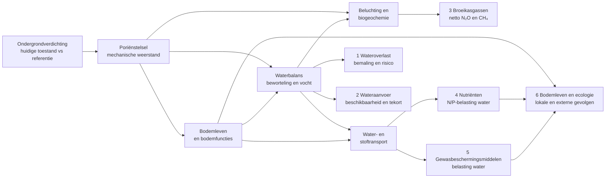
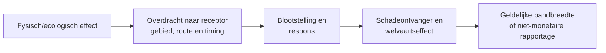

# Causaal netwerk ondergrondverdichting v0.5: hoofdfiguur

**12 oktober 2026 | DISCUSSION_DRAFT | leesversie voor experts en LVVN.**  
Zie [technisch netwerk v0.5](87_causaal_netwerk_technisch_v0_5.md) voor de genummerde relaties en [review v0.4](85_kritische_review_causaal_netwerk_v0_4.md) voor de aanpassingen. Deze versie is geen vastgesteld rekenmodel.

## Hoofdfiguur: één bodem, zes effectcategorieën

**Leesregel:** de figuur laat *mogelijke* oorzakelijke routes zien, geen universele effectrichting. Wateroverlast, watervraag, emissies en milieubelasting kunnen per bodem, seizoen en beheer verschillen. De categorieën zijn werksporen, geen onafhankelijke schadeposten. On-site en off-site zijn geen aparte fysische processen.

## Overgang van proces naar maatschappelijk gevolg

De tussenstappen verschillen per categorie: voor water telt netwerkcapaciteit en beheer, voor stoffen vracht, retentie, concentratie en toxiciteit, voor emissies de nettoflux en gekozen waarderingsbasis. **Niet halen van een KRW- of emissiedoel is geen automatisch bedrag in euro's.** Vermeden reductiemaatregelen en vermeden milieuschade kunnen hetzelfde probleem waarderen, en mogen niet zonder scenario- en dubbeltellingcontrole worden opgeteld.

## De zes categorieën in gewone taal

| Categorie | Kernmechanisme | Mogelijke eindpunten | Voornaamste onzekerheid |
|---|---|---|---|
| 1 Wateroverlast | Veranderde infiltratie, berging, afvoer en netwerkrouting | Extra bemaling, schade bij overschrijding capaciteit | Perceelrespons versus regionaal effect |
| 2 Wateraanvoer | Beworteling, waterbeschikbaarheid, actuele opname en regionale watervraag | Aanvoerkosten, tekort voor gebruikers, effecten op grondwater | Waterbalans en gedrag/allocatie |
| 3 Broeikasgassen | Beluchting, redox, N- en C-omzettingen | Netto N₂O en CH₄ | Productie versus consumptie, context |
| 4 Nutriënten | Hydrologische route en N/P-mobilisatie | N/P-vracht en receptorrespons | Concentratie, route, retentie |
| 5 Gewasbeschermingsmiddelen | Afvoerroute plus toepassings- en stofgedrag | Middel-specifieke vracht en blootstelling | Timing, stofeigenschappen, toxiciteit |
| 6 Bodemleven/ecologie | Habitat en bodemfuncties, plus waterkwaliteit | Bodembiodiversiteit, externe ecologische gevolgen | Externe receptor en afzonderlijke bijdrage |

## Gemeenschappelijke on-site toets

Gewasopbrengst staat niet als zevende off-site effectcategorie in de hoofdfiguur. De on-site berekening gebruikt de huidige verdichtingskaart, gewas/bodem-combinaties en empirische opbrengstrelaties, daarna bedrijfstypen en bouwplannen. De technische figuur beschrijft wortel- en waterprocessen als verklaring. Tel deze processen niet afzonderlijk bij de al gemeten opbrengstderving op. De mogelijkheid van betere draagkracht of capillaire nalevering wordt als *mogelijke* baat onderzocht, niet als vaststaand voordeel.

## Toestand, referentie en besluitpunten

**Primair:** jaarlijkse gevolgen van de huidige ondergrondverdichting versus een fysisch samenhangende referentie zonder schadelijke antropogene ondergrondverdichting. Dit is niet automatisch de toestand 'ongerept', niet automatisch direct herstelbaar en niet het scenario 'verdichting gaat nog twintig jaar door'.

De bulkdichtheidscijfers 1,2/1,4/1,7 g/cm³ uit de vergadering zijn illustratief, bodemtypeafhankelijk en niet bruikbaar als algemene drempels. Voor veen ontbreken nog passende criteria. Controleer of de bestaande bodemfysische modelinvoer al historische verdichting bevat.

**Voor presentatie:** toon eerst deze figuur, bespreek één route met een concreet voorbeeld, laat daarna het technische netwerk zien als onderbouwing. De technische versie bevat meer hypotheses dan al zijn geverifieerd.

**Status:** alleen conceptuele mechanisme-indeling. Geen nieuwe landelijke schadecoëfficiënt, monetair effect of wetenschappelijke validatie toegelaten.
