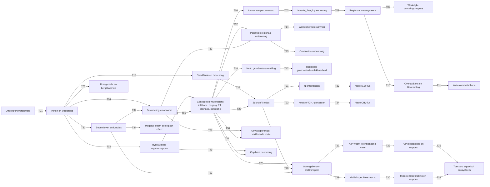

# Causaal netwerk ondergrondverdichting v0.5: technisch netwerk en register

**12 oktober 2026 | TECHNICAL_DISCUSSION_DRAFT | geen empirische admission.**  
Samen met [de hoofdfiguur](86_causaal_netwerk_hoofdfiguur_v0_5.md) vormt dit de v0.5. Gebaseerd op [v0.3](81_causaal_netwerk_volledig_gecodeerd_v0_3.md), [v0.4](84_causaal_netwerk_geactualiseerd_na_expertoverleg_v0_4.md) en [kritische review](85_kritische_review_causaal_netwerk_v0_4.md).

## Ontwerpprincipes

1. Elke zichtbare **causale** pijl in de onderstaande technische figuur draagt één unieke **T-code**. Een code identificeert een conceptuele hypothese, niet haar bewijsstatus.
2. Bestaande C01–C28 blijven in hun bronbestanden onveranderd. Onderstaande crosswalk is inhoudelijk, soms één op meerdere; T-codes zijn geen stilzwijgende vervanging.
3. Gedeelde waterbalansvariabelen vormen een gekoppeld processtelsel; geen losse 'ET veroorzaakt percolatie'-pijl. Geen direct ammoniak-eindpunt zonder nieuw onderbouwd traject.
4. Geen kwantitatieve schade zonder counterfactual, gebieds-/seizoenscontext, overdracht en receptor.

## Gecodeerd technisch netwerk

**Let op:** T12 en T13 geven slechts een conceptuele mogelijke invloed op *extra regionaal gevraagde waterlevering*. Verdampingsvraag van een gewas en beheerdersbesluit tot wateraanvoer zijn niet hetzelfde. T16 vereist beoordeling van de regionale grondwaterbalans en kan niet uit 'percolatie' alleen worden afgeleid. T26 is stofspecifiek. T34 is uitsluitend een te toetsen hypothese.

## Register van alle 41 technische pijlen

| T-code | Van → naar | Betekenis en voornaamste begrenzing | Legacy / beoordeling |
|---|---|---|---|
| T01 | Verdichting → poriën | Structuur, anisotropie en weerstand veranderen met belasting | C01 |
| T02 | Poriën → hydraulische eigenschappen | Doorlatendheid, retentie en berging bodemtypeafhankelijk | C02 |
| T03 | Hydrauliek → waterbalans | Gekoppelde fluxen, met klimaat, beheer en onderrand | C03 |
| T04 | Poriën → beworteling | Diepte, mechanische weerstand en gewas bepalen respons | C08 |
| T05 | Beworteling → waterbalans | Wortelwateropname/ET en verdeling van vochtfluxen | X02; nieuw gegroepeerd |
| T06 | Waterbalans → perceelsrandafvoer | Runoff en drainafvoer met timing en richting | C04 |
| T07 | Perceelsrand → levering/routing | Connectiviteit, lokale opslag, sloten en drains | X12, deel C05 |
| T08 | Levering → systeem | Reistijd, samenloop, bestaande belasting en beheer | X13, deel C05 |
| T09 | Systeem → bemalingsrespons | Pompregime, peilregels en extra energie | C06 |
| T10 | Systeem → overlastkans/blootstelling | Capaciteit, kans en locaties van objecten | C07 deels |
| T11 | Blootstelling → schade | Schadefunctie, kwetsbaarheid en eventuele herstelmaatregelen | C07 deels; economische brug |
| T12 | Waterbalans → regionale watervraag | Van lokale tekorten naar potentiële vraag, gedrag ontbreekt | C10 deels |
| T13 | Beworteling → regionale watervraag | Via beschikbaar water, niet via een vaste factor | C09 deels |
| T14 | Vraag → werkelijke wateraanvoer | Allocatie, infrastructuur en beschikbaarheid | C11 |
| T15 | Vraag → onvervulde vraag | Aanbodbeperking, gebruikersgedrag en spreiding | C12 |
| T16 | Waterbalans → netto grondwateraanvulling | Vereist juiste onderrand, kwel en laterale stromen | X01, X03 herwerkt |
| T17 | Aanvulling → regionale beschikbaarheid | Regionale systeemrespons en onttrekkingen | X04 |
| T18 | Poriën → gastransport | Luchtgevulde poriën, vocht en diffusie | C13 |
| T19 | Gastransport → redox | Diffusie én zuurstofvraag | C14 |
| T20 | Waterbalans → redox | Verzadiging, duur van zuurstofgebrek | C15 |
| T21 | Redox → N-omzettingen | N-aanbod en nitrificatie/denitrificatie | C16 |
| T22 | N-omzettingen → netto N₂O | Productie en N₂O-reductie apart | C17 |
| T23 | Redox → koolstof-/CH₄-processen | Organische substraatvoorraad, methanogenese en oxidatie | C18, X09 |
| T24 | CH₄-processen → netto CH₄ | Productie, oxidatie en transport | C18, X10 |
| T25 | Waterbalans → transport | Fluxroute, preferente stroming en stoffront | C19 |
| T26 | Redox → transport | Alleen relevante redoxgevoelige verbindingen | C20, geen universele pesticide-route |
| T27 | Transport → N/P-vracht | Concentratie × flux, retentie en route | C21 |
| T28 | Transport → middelenvracht | Middeltoepassing, sorptie, timing en afbraak | C22 |
| T29 | N/P-vracht → receptorrespons | Verdunning, retentie, achtergrond en ecologische respons | C27 deels |
| T30 | Middelenvracht → receptorrespons | Blootstelling, toxiciteit en receptor | C28 deels |
| T31 | Poriën → bodemleven | Habitat, biota en functies, veel contextafhankelijkheid | C23 |
| T32 | Bodemleven → beworteling | Mediator, geen onafhankelijke extra schade | C24 |
| T33 | Bodemleven → transport | Organische stof, structuur en biogeochemie | C25 |
| T34 | Bodemleven → extern ecologisch effect | Externe receptor ontbreekt vaak; alleen hypothese | C26 |
| T35 | N/P-respons → ecologische toestand | Kwaliteit ontvangend systeem | C27 deels |
| T36 | Middelenrespons → ecologische toestand | Stoffen- en systeemafhankelijk | C28 deels |
| T37 | Beworteling → gewasopbrengst | Verklarend on-site, niet extra optellen | X06 |
| T38 | Waterbalans → gewasopbrengst | Water-/zuurstofstress en groeiseizoen; gecombineerd | X07 |
| T39 | Poriën → draagkracht/berijdbaarheid | Diepte en vocht; mogelijke baat of last | X08 |
| T40 | Hydrauliek → capillaire nalevering | Gradiënt en hydraulische eigenschappen | X05 herwerkt |
| T41 | Waterbalans → capillaire nalevering | Grondwaterstand en actuele vochttoestand | X05 herwerkt |

**Eén relatie, één code:** de technische figuur bevat 41 T-codes, ieder eenmaal. De crosswalk laat zien dat sommige C-codes zijn opgesplitst en enkele X-relaties niet zelfstandig behouden zijn.

## Beoordeling van X01–X13, inclusief niet overgenomen routes

| X-code v0.4 | Behandeling in v0.5 | Motivering |
|---|---|---|
| X01 | T16 | Alleen als waterbalans en grondwateraanvulling gespecificeerd zijn |
| X02 | T05 | Werkelijke opname en transpiratie |
| X03 | Niet als zelfstandige pijl | Balansafhankelijkheid, geen directe autonome oorzaak |
| X04 | T17 | Gebiedsafhankelijk |
| X05 | T40–T41 | Twee bepalende factoren, mogelijke baat |
| X06 | T37 | Verklarende on-site route |
| X07 | T38 | Samengestelde on-site route |
| X08 | T39 | Draagkracht versus bewerkbaarheid blijft open |
| X09 | T23 | Uitsplitsing C18 |
| X10 | T24 | Uitsplitsing C18 |
| X11 | **Niet opgenomen** | NH3-route wetenschappelijk onvoldoende gedefinieerd |
| X12 | T07 | Uitsplitsing C05 |
| X13 | T08 | Uitsplitsing C05 |

## Wat betekent een niet volledig gemodelleerde pijl?

De figuur is een **conceptueel netwerk**. Zij mist bijvoorbeeld expliciete externe stuurvariabelen als neerslag, temperatuur, mestgift, toepassing van middelen, grondwaterstand, bodemtextuur, peilbeheer en drainconfiguratie. Dat betekent dat de figuur geen compleet dynamisch causaal model is. De pijlen vereisen steeds een conditietabel met contextvariabelen en bronnen voordat berekeningen worden toegestaan.

De technische figuur toont niet automatisch een *netto* milieueffect: van N/P-vracht naar aquatische toestand ontbreken complexe terugkoppelingen en verblijftijden. De tekenrichting is niet door een pijl vastgelegd. Extra aandacht voor positieve effecten (onder omstandigheden meer capillaire nalevering, hogere draagkracht of minder verticale uitspoeling), maar geen bewezen batenclaim.

## R1–R4 en economische incidentie

- **R1:** aantoonbaar fysiek verschil in huidig-versus-referentiescenario en bewijskracht.
- **R2:** receptor, afstand, schaal, betrokken actor en blootstelling.
- **R3:** waarderingsbasis, eenheden, prijsjaar, tijdsduur en onderscheid schade / feitelijke beheeruitgaven / beleidsmaatregel.
- **R4:** niet-monetariseerbare effecten en controle op dubbeltelling en interacties.

On-site resultaten uit empirische opbrengstproeven worden **niet** nogmaals als gewasstresseffect opgeteld. Kosten van extra bemaling en schade door overstroming worden alleen separaat gewaardeerd als beide werkelijk additioneel zijn. Vermeden maatregelen ten behoeve van KRW of emissiedoelen vergen expliciete beleidscounterfactual. Ecologische resultaten blijven opgenomen als niet monetariseerbaar.

## Vergelijking en scenario

De primaire vergelijking betreft huidige ondergrondverdichting versus een onderbouwde referentietoestand zonder schadelijke antropogene ondergrondverdichting, **bij gelijkblijvende overige omstandigheden voor zover verdedigbaar**. Bulk-dichtheidsgrenzen verschillen naar textuur; de genoemde 1,2/1,4/1,7 g/cm³ zijn illustratief, niet universeel. Veen vergt afzonderlijke toetsing. Bestaande BOVEC-/SWAP-parameters kunnen reeds verdichting bevatten. Toekomstige trends en preventie/herstel zijn latere, afzonderlijke scenario's.

## Minimale voorwaarden voor toelating van een pijl

1. Context: bodemtype, landgebruik, diepte, toestand en referentie.
2. Mechanisme: fysisch consistente definitie van bron en doelvariabele.
3. Empirische bron of voldoende gekwalificeerd model; benoem bewijskracht en beperkingen.
4. Mogelijke effectrichting en tekenomslag, onzekerheid en ruimtelijke schaal.
5. Externe receptor aantoonbaar voor off-site en dubbeltelling uitgesloten voor monetair totaal.

**Aanbeveling:** gebruik v0.5 in expertbespreking. Pas na gerichte literatuur- en expertscreening de technische pijlen en eventuele berekeningen formeel vaststellen.
