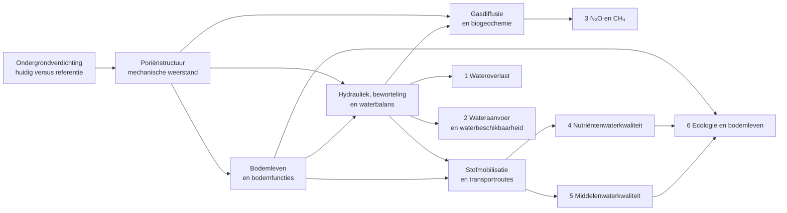
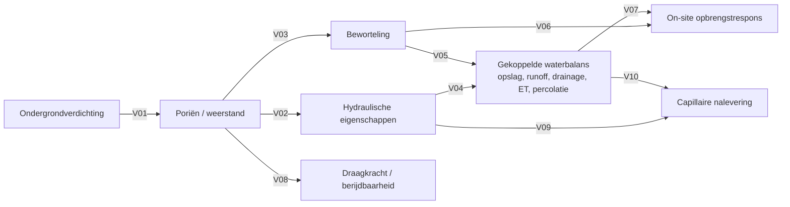
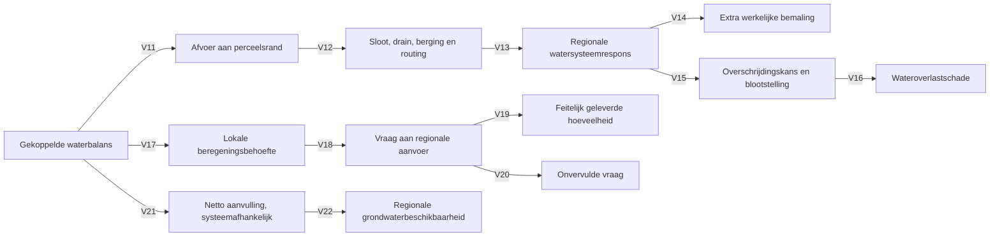
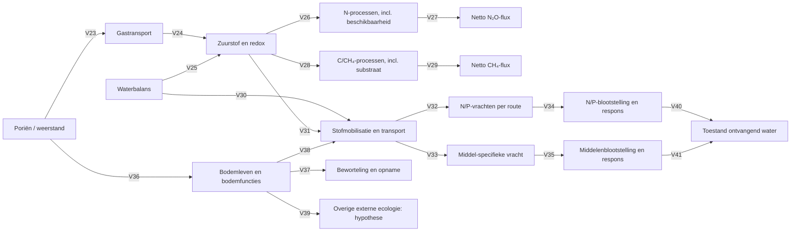

# Causaal netwerk ondergrondverdichting v0.6

**12 oktober 2026 | DISCUSSION_DRAFT | ontwerp voor externe experttoets, geen wetenschappelijke admission**

**Vervangt v0.5 als bespreekversie, niet als archief.** [Hoofdfiguur v0.5](86_causaal_netwerk_hoofdfiguur_v0_5.md), [technisch netwerk v0.5](87_causaal_netwerk_technisch_v0_5.md) en [review v0.4](85_kritische_review_causaal_netwerk_v0_4.md) blijven behouden. De historische C01–C28 zijn onveranderd en zijn terug te vinden in [matrix 81](81_causaal_netwerk_volledig_gecodeerd_v0_3.md).

## Hoofdfiguur: zes werksporen, gedeelde processen

De pijlen zijn conceptueel, niet gekalibreerd. De categorieën zijn geen zelfstandig optelbare eurobedragen; emissies en stofvrachten worden pas na plaats, receptor, blootstelling en waardering maatschappelijke eindpunten.

## Technische deelroutes met expliciete pijl-ID's

De technische figuren gebruiken **V-codes**, uitsluitend als bespreek-ID's. Ze hernummeren C01–C28 niet. Contextvariabelen (klimaat, bodemtype, landgebruik, bemesting, toepassingsregime, waterbeheer) worden bij iedere route apart geregistreerd en zijn geen automatisch aan verdichting toe te rekenen effecten.

### A. Gedeelde bodemprocessen, on-site en waterbalans

**Waterbalans is één samenhangend controlevolume.** ET, drainage, runoff en percolatie zijn geen onafhankelijke causale factoren. On-site opbrengstschade is primair empirisch te schatten per gewas, bodem en verdichtingsklasse; V06 en V07 zijn alleen verklarend. Positieve effecten van draagkracht of nalevering zijn nog hypothesen.

### B. Wateroverlast, wateraanvoer en grondwater

Beregeningsbehoefte is niet automatisch regionale aanvoer; ook bronkeuze, infrastructuur en allocatie bepalen de uitkomst. Netto aanvulling kan niet worden gelijkgesteld aan percolatie onder de wortelzone. Overlast en bemaling zijn niet automatisch beide additionele schadeposten.

### C. Emissies, stoffen en ecologie

**Stofbronnen staan als expliciete voorwaarden naast dit netwerk:** mestgift, gewasbeschermingsmiddeltoepassing, tijdstip, sorptie, afbraak en achtergrondbelasting. Netto-emissies vereisen productie, omzetting, consumptie en transport. V31 is stofspecifiek; niet als generieke pesticide-effectfactor interpreteren. V39 is hypothese totdat een onafhankelijke externe receptor is aangetoond. NH₃ wordt niet in de broeikasgascategorie opgenomen.

## Verantwoordingsregister V01–V41 en crosswalk vanuit T01–T41

| V-relatie | Oorsprong T v0.5 | Wijziging |
|---|---|---|
| V01–V04 | T01–T03, T04 | Bodemstructuur en hydrauliek gescheiden van beworteling |
| V05–V07 | T05, T37–T38 | Wortelopname en empirische gewasrespons gescheiden |
| V08–V10 | T39–T41 | Mogelijke baten conditioneel behouden |
| V11–V16 | T06–T11 | Perceelsrand, routing, bemaling, overschrijding en schade expliciet |
| V17–V20 | T12–T15 | Regionale watervraag opgesplitst in beregeningsbehoefte, levering en tekort |
| V21–V22 | T16–T17 | Netto grondwateraanvulling als systeemafhankelijk eindpunt |
| V23–V29 | T18–T24 | Gasdiffusie, redox, afzonderlijke N₂O/CH₄-processen |
| V30–V35 | T25–T30 | Transport en receptorrespons apart; bronfactoren als externe voorwaarden |
| V36–V41 | T31–T36 | Bodemleven plus aquatische en eventueel andere externe effecten |

**Opmerking bij crosswalk:** T13 (beworteling → regionale vraag) is niet één-op-één overgenomen: beïnvloeding van de beregeningsbehoefte loopt in v0.6 via de gedeelde waterbalans en lokale waterbeschikbaarheid. T40–T41 zijn behouden als potentieel conditionele effecten. Dit is een inhoudelijke crosswalk, geen letterlijke hercodering van elke bron-doelcombinatie.

## Narratieven: links naar rechts en rechts naar links

| Effect | Oorzaak → gevolg | Gevolg → mogelijke bijdrage verdichting |
|---|---|---|
| Wateroverlast | Verdichting → hydrauliek → gebeurtenisafhankelijke perceelsafvoer → netwerkrouting → systeemrespons → kans/blootstelling → schade | Begin bij waargenomen overlast, reconstrueer gebeurtenis en herkomst van de kritieke belasting, vergelijk met een niet-verdicht referentieprofiel |
| Wateraanvoer | Verdichting → beworteling/waterbalans → lokale beregeningsbehoefte → bronkeuze en regionale leveringsvraag → kosten, beschikbaarheid of tekort | Begin bij aanvoer en schaarste, splits functies en bronnen, bepaal het marginale effect van verdichting op lokale vraag en regionale allocatie |
| Broeikasgassen | Verdichting → gas-/watertransport → redox + N- en C-processen → netto N₂O/CH₄ → klimaateffect | Begin bij landbouwemissies, onderscheid N- en CH₄-processen en schat een verdicht/niet-verdicht verschil per representatieve situatie |
| Nutriënten | Verdichting → waterroute/redox → stofmobilisatie → N/P-vracht → blootstelling → waterkwaliteit | Begin bij belasting van een waterlichaam, onderscheid bronnen/routes en beoordeel het marginale aandeel van verdichting, niet de hele landbouwvracht |
| Gewasbeschermingsmiddelen | Verdichting → gewijzigde afvoerroutes, in interactie met toepassing/stofgedrag → middelvracht → blootstelling → ecologisch risico | Begin bij normoverschrijding of stofbelasting, onderscheid drift/toepassing en bodemgebonden routes; bereken de verschilsituatie |
| Bodemleven/ecologie | Verdichting → habitat en functies → lokale ecologische toestand en mogelijke doorwerking naar wortels, stoffen en externe receptor | Begin bij een specifiek ecologisch eindpunt, toets concurrerende oorzaken en vraag of verdichting een afzonderlijke bijdrage heeft |

## Sociaaleconomische uitkomst en dubbeltellingen

Rapporteer per eindpunt: bron- en doeleenheid, huidige en referentiesituatie, receptor, getroffen actor, schaal, bewijskracht, prijsjaar en onzekerheid. Scheid directe verliezen, extra beheeruitgaven, milieuschade, hypothetisch vermeden beleidsmaatregelen en niet-monetariseerbare gevolgen. Een KRW-doeltekort is niet rechtstreeks een eurobedrag. Een kwantitatieve raming is niet vereist om een relevant ecologisch effect te blijven rapporteren.

## Open punten voor externe beoordeling

1. Representatieve verdichtingsklassen en bodemfysische referenties, vooral voor veen.
2. Bestaande modelinvoer bevat mogelijk al historische verdichting; controleer BOVEC/SWAP-profielen.
3. Hoe vertalen we 2024-dichtheidsmetingen naar hydraulische eigenschappen en schaalbare representatieve situaties?
4. Welke empirische opbrengstrelaties zijn geldig voor gewas × bodem × ernst × seizoen?
5. Hoe worden gebeurtenissen en netwerkrespons op landelijke schaal geaggregeerd zonder universele afvoerfactor?
6. Welke emissie- en stofroutes hebben werkelijk meetbaar ondergrondeffect?
7. Wat geldt bij bodemleven als afzonderlijke externe receptor?
8. Welke waarderingsgrondslag past per effect, en hoe vermijden we dubbeltelling?

**Versiestatus:** deze v0.6 is een beter gestructureerd discussie- en memo-raamwerk, maar de 41 V-relaties zijn niet afzonderlijk met literatuur gevalideerd. Voor definitieve toelating zijn een bron- en conditietabel en externe toets nodig.
